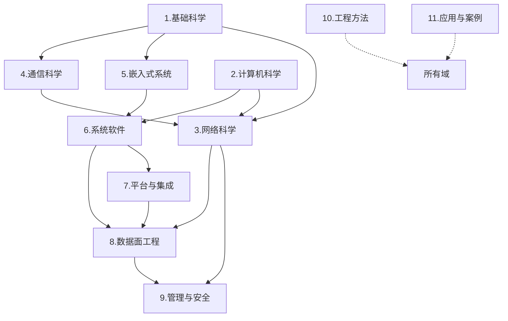

# 知识框架

> 这是一份**知识框架**，不是课程表，也不是项目计划。
> 组织轴是“学科/知识域”，不是“某个平台（OpenWrt）”，也不是“某个项目周期”。

## 1. 三条轴

### 轴 A：知识域（主组织轴）

| # | 知识域 | 回答什么问题 | 入口 |
|---|---|---|---|
| 1 | 基础科学 | 数学/物理/电子/信号给工程什么约束 | [进入](../1.基础科学/00-总览.md) |
| 2 | 计算机科学 | 语言、数据结构、算法、脚本 | [进入](../2.计算机科学/00-总览.md) |
| 3 | 网络科学 | 协议怎么工作、地址/路由/传输/应用 | [进入](../3.网络科学/00-总览.md) |
| 4 | 通信科学 | 无线/蜂窝/射频：信号怎么发、终端怎么入网 | [进入](../4.通信科学/00-总览.md) |
| 5 | 嵌入式系统 | 板子怎么起来、硬件怎么描述、外设怎么接 | [进入](../5.嵌入式系统/00-总览.md) |
| 6 | 系统软件 | 内核/驱动/网络栈怎么实现 | [进入](../6.系统软件/00-总览.md) |
| 7 | 平台与集成 | 怎么把系统集成为可交付设备（OpenWrt/Yocto 等） | [进入](../7.平台与集成/00-总览.md) |
| 8 | 数据面工程 | 包怎么转发：交换/NAT/QoS/加速 | [进入](../8.数据面工程/00-总览.md) |
| 9 | 管理与安全 | 设备怎么被管理、怎么可信 | [进入](../9.管理与安全/00-总览.md) |
| 10 | 工程方法 | 怎么调试、测试、证明结论 | [进入](../10.工程方法/00-总览.md) |
| 11 | 应用与案例 | 项目/认证/产线/运维（应用层） | [进入](../11.应用与案例/00-总览.md) |

### 轴 B：抽象层（同一知识域内部）

| 层 | 写什么 | 不写什么 |
|---|---|---|
| L1 理论 | 概念、模型、边界、协议规范 | 配置步骤、平台细节 |
| L2 实现 | 内核/驱动/用户态怎么实现 | 重抄 L1 定义 |
| L3 工程 | 怎么配、怎么抓、怎么验证、怎么排错 | 重抄 L1/L2 |
| L4 应用 | 项目、认证、产线、运维 | 重抄技术原理 |

### 轴 C：横切视角（按需切换，不是目录）

| 视角 | 用途 | 入口 |
|---|---|---|
| 协议层（PHY→APP） | 看一个包在各层的形态 | [网络原理](../3.网络科学/1.网络原理/00-总览.md) + [通信科学](../4.通信科学/00-总览.md) |
| 实现链（硬件→内核→用户态→云） | 定位问题落在哪一层 | [嵌入式](../5.嵌入式系统/00-总览.md) → [系统软件](../6.系统软件/00-总览.md) → [平台](../7.平台与集成/00-总览.md) |
| 生命周期（设计→验证→部署→运维） | 项目交付 | [应用与案例](../11.应用与案例/00-总览.md) |

## 2. 域间依赖



> 实线是“概念/实现依赖”，虚线是“方法/验证反哺”。

## 3. 域的边界（防止重复）

| 容易混的内容 | 唯一归属 | 其他位置只链接 |
|---|---|---|
| 协议报文/状态机 | 3.网络科学 | 平台配置、数据面实现 |
| 内核收发包/驱动 | 6.系统软件 | 数据面/平台 |
| DSA/NAT/QoS/转发加速实现 | 8.数据面工程 | 网络科学只讲原理 |
| OpenWrt 构建/启动/配置/升级 | 7.平台与集成/1.OpenWrt | 其他域不写 OpenWrt 细节 |
| Yocto/Buildroot | 7.平台与集成/2.构建系统 | — |
| 无线/蜂窝空口/模组接口 | 4.通信科学 | 网络科学只讲 IP 以上 |
| 管理协议/VPN/证书 | 9.管理与安全 | 产品合规只写验收 |
| 项目/认证/产线/运维 | 11.应用与案例 | 不进入知识域主干 |
| 调试/测试/抓包方法 | 10.工程方法 | 各域只引用方法 |

## 4. 定位决策树

```text
你要解决的问题是什么？
├─ 信号/空口/入网/天线 → 4.通信科学
├─ IP/路由/传输/应用协议 → 3.网络科学
├─ 板子/启动/分区/外设 → 5.嵌入式系统
├─ 内核/驱动/网络栈 → 6.系统软件
├─ 构建/固件/平台配置/升级 → 7.平台与集成
├─ 转发/NAT/QoS/加速 → 8.数据面工程
├─ ACS/SNMP/VPN/证书 → 9.管理与安全
├─ 怎么调/怎么测/怎么抓 → 10.工程方法
├─ 项目/认证/产线/现场 → 11.应用与案例
└─ 底层约束（数学/电磁/电路） → 1.基础科学
```

## 5. 三条铁律

1. **单一归属**：一个知识点只有一个主文件；其他位置只能链接。
2. **平台是实例，不是中心**：OpenWrt 放在 `7.平台与集成/1.OpenWrt`；不因项目用它就把整库按它组织。
3. **应用是验证，不是主干**：项目/产品内容放 `11.应用与案例`，用来反哺知识域，不反向定义知识结构。

## 6. 反模式（本库明确避免）

| 反模式 | 为什么不行 |
|---|---|
| 按“我最近在学什么”建目录 | 学习顺序会变，知识结构不应随计划漂移 |
| 按“项目阶段/天数”建目录 | 项目结束，结构就失效 |
| 以 OpenWrt 为顶层域 | 它只是嵌入式 Linux 的一个发行版/平台实例 |
| 以厂商/芯片型号为顶层域 | 型号会淘汰，知识域相对稳定 |
| 协议原理与平台配置混写 | 同一事实多处维护，必然过期 |
| 把 PDF/源码当笔记 | 资料不是知识，必须索引 + 消化 |
| 用“深度分析报告”代替章节 | 报告是一次性的，章节是可维护的 |

## 7. 当前状态（详版已补）

> 已按“工程详版”补齐：原理/模型/公式、机制流程、工程配置、验证实验、故障模式、取舍与参考。
> 仍缺的是**实测数据、真实案例、具体硬件参数**——这些不能用文字补，必须用设备/现场补。

| 域 | 状态 | 已补内容 |
|---|---|---|
| 1.基础科学 | 详版已补 | [概率与排队论](../1.基础科学/1.数学/01-概率与排队论.md)、[线性代数与优化](../1.基础科学/1.数学/02-线性代数与优化.md)、[电磁波与传播](../1.基础科学/2.物理与电磁/01-电磁波与传播.md)、[接地屏蔽与EMC](../1.基础科学/2.物理与电磁/02-接地屏蔽与EMC.md)、[电源与PoE](../1.基础科学/3.电子电路/01-电源与PoE.md)、[SI](../1.基础科学/3.电子电路/02-信号完整性与高速接口.md)、[傅里叶与频谱](../1.基础科学/4.信号与系统/01-傅里叶与频谱.md)、[调制采样与噪声](../1.基础科学/4.信号与系统/02-调制采样与噪声.md) |
| 2.计算机科学 | 详版已补 | [算法设计](../2.计算机科学/2.数据结构与算法/02-算法设计.md)、[并发与同步](../2.计算机科学/4.并发与系统编程/01-并发与同步.md)、[代码质量与测试](../2.计算机科学/5.软件工程/01-代码质量与测试.md) |
| 3.网络科学 | 详版已补 | [IPv6 过渡与CPE部署](../3.网络科学/1.网络原理/09-IPv6过渡与CPE部署.md)、[策略路由与多WAN](../3.网络科学/5.路由与组播/03-策略路由与多WAN.md)、[组播转发与snooping](../3.网络科学/5.路由与组播/04-组播转发与snooping.md) |
| 4.通信科学 | 详版已补 | [链路预算与EIRP](../4.通信科学/3.射频与天线/01-链路预算与EIRP.md)、[天线选型与安装](../4.通信科学/3.射频与天线/02-天线选型与安装.md)、[传播模型与勘测](../4.通信科学/3.射频与天线/03-传播模型与现场勘测.md)、[NR物理层](../4.通信科学/2.蜂窝与终端/15-NR物理层.md)、[ODU现场测试](../4.通信科学/2.蜂窝与终端/16-ODU现场测试.md)、[锁频锁小区](../4.通信科学/2.蜂窝与终端/17-锁频锁小区与信号优化.md) |
| 5.嵌入式系统 | 详版已补 | [电源树与功耗预算](../5.嵌入式系统/2.电源与热设计/01-电源树与功耗预算.md)、[热设计与降频](../5.嵌入式系统/2.电源与热设计/02-热设计与降频.md)、[高速接口SI](../5.嵌入式系统/3.信号完整性与EMC/01-高速接口SI.md)、[EMC与ESD](../5.嵌入式系统/3.信号完整性与EMC/02-EMC与ESD.md)、[产测与老化](../5.嵌入式系统/4.硬件量产测试/01-产测与老化.md) |
| 6.系统软件 | 详版已补 | [字符设备驱动](../6.系统软件/1.Linux内核与驱动/07-驱动实战-字符设备.md)、[平台设备与DTS](../6.系统软件/1.Linux内核与驱动/08-驱动实战-平台设备与DTS匹配.md)、[内存管理](../6.系统软件/1.Linux内核与驱动/09-内存管理与调试.md)、[锁调试](../6.系统软件/1.Linux内核与驱动/10-并发与锁调试.md) |
| 7.平台与集成 | 详版已补 | [Buildroot](../7.平台与集成/2.构建系统/04-Buildroot.md)、[厂商SDK与BSP](../7.平台与集成/2.构建系统/05-厂商SDK与BSP.md)、[构建系统选型](../7.平台与集成/2.构建系统/06-构建系统选型.md) |
| 8.数据面工程 | 详版已补 | [DSA实战](../8.数据面工程/07-DSA实战-VLAN与端口隔离.md)、[加速兼容性矩阵](../8.数据面工程/08-硬件加速兼容性矩阵.md) |
| 9.管理与安全 | 详版已补 | [NETCONF/YANG](../9.管理与安全/1.终端管理/06-NETCONF与YANG.md)、[802.1X](../9.管理与安全/3.安全与认证/02-802.1X与EAP.md)、[漏洞与SBOM](../9.管理与安全/3.安全与认证/03-漏洞管理与SBOM.md) |
| 10.工程方法 | 详版已补 | [自动化测试](../10.工程方法/5.测试与实验/03-自动化测试.md)、[性能基准](../10.工程方法/5.测试与实验/04-性能基准方法.md)、[可靠性与老化](../10.工程方法/5.测试与实验/05-可靠性与老化.md) |
| 11.应用与案例 | 详版已补 | [PPPoE失败](../11.应用与案例/5.运维与故障案例/02-PPPoE拨号失败.md)、[WiFi速率低](../11.应用与案例/5.运维与故障案例/03-WiFi速率低.md)、[5G掉线](../11.应用与案例/5.运维与故障案例/04-5G掉线.md)、[升级变砖](../11.应用与案例/5.运维与故障案例/05-升级变砖.md)、[产线数据模板](../11.应用与案例/4.生产与校准/02-产线数据模板.md)、[现场记录模板](../11.应用与案例/5.运维与故障案例/06-现场记录模板.md) |

## 8. 相关

- [知识框架图](知识框架图.md)：可视化 + 可点击索引
- [视图/学习路径](视图/学习路径.md)：可选的学习顺序（不是框架）
- [术语与缩略语](术语与缩略语.md)
- [平台与版本矩阵](平台与版本矩阵.md)
- [文档规范](文档规范.md)
