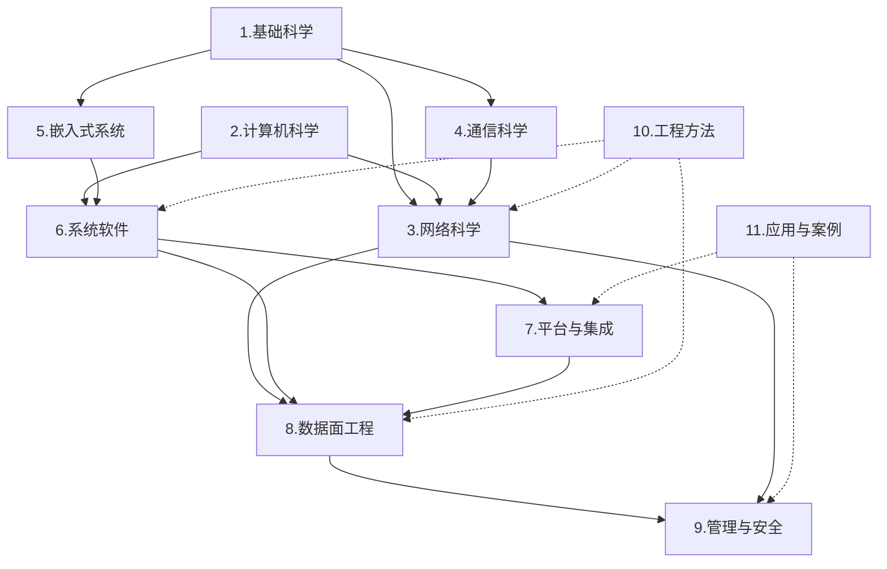
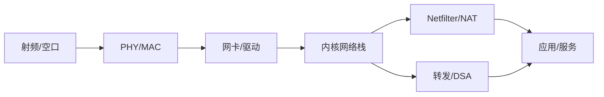

# 知识框架图

> 这张图把**知识域、概念、实现、应用**串起来；它不是课程表，也不是项目排期。
> 先看域间关系，再按“包的一生 / 一次入网 / 一次升级”三条主线跳转。

## 1. 域间关系

> 实线：概念/实现依赖；虚线：方法/验证反哺。

## 2. 三条主线

### 2.1 一个包的一生（数据面）

| 步 | 概念 | 去哪里 |
|---:|---|---|
| 1 | 射频/空口 | [通信科学](../4.通信科学/00-总览.md) |
| 2 | PHY/MAC | [802.11 原理](../4.通信科学/1.无线/01-802.11原理.md) |
| 3 | 网卡/驱动 | [驱动模型](../6.系统软件/1.Linux内核与驱动/04-驱动模型.md) |
| 4 | 内核网络栈 | [网络栈](../6.系统软件/1.Linux内核与驱动/03-网络栈.md) |
| 5 | Netfilter/NAT | [Netfilter与防火墙](../8.数据面工程/02-Netfilter与防火墙.md) |
| 6 | 转发/DSA | [DSA与交换机](../8.数据面工程/01-DSA与交换机.md) |
| 7 | 应用/服务 | [应用层协议](../3.网络科学/1.网络原理/06-应用层协议.md) |

### 2.2 一次入网（蜂窝/ODU）

| 步 | 概念 | 去哪里 |
|---:|---|---|
| 1 | SIM/UIM | [QMI UIM](../4.通信科学/2.蜂窝与终端/09-QMI-UIM.md) |
| 2 | 入网信令 | [终端入网流程](../4.通信科学/2.蜂窝与终端/06-终端入网流程.md) |
| 3 | QMI/MBIM | [QMI NAS](../4.通信科学/2.蜂窝与终端/07-QMI-NAS.md) |
| 4 | 数据通路 | [Modem IPA](../4.通信科学/2.蜂窝与终端/11-Modem-IPA.md) |
| 5 | 拨号配置 | [5G 拨号](../7.平台与集成/1.OpenWrt/4.网络业务/1.WAN/03-5G拨号配置.md) |
| 6 | ODU 整机 | [ODU 与 IDU](../4.通信科学/2.蜂窝与终端/13-ODU与IDU.md) |

### 2.3 一次升级（平台/集成）

| 步 | 概念 | 去哪里 |
|---:|---|---|
| 1 | 镜像生成 | [镜像原理](../7.平台与集成/1.OpenWrt/1.构建体系/05-镜像原理/00-总览.md) |
| 2 | 启动链 | [启动链与 U-Boot](../5.嵌入式系统/1.硬件与板级/01-启动链与U-Boot.md) |
| 3 | 设备树 | [设备树与 DTS](../5.嵌入式系统/1.硬件与板级/02-设备树与DTS.md) |
| 4 | 分区/存储 | [存储与分区](../5.嵌入式系统/1.硬件与板级/03-存储与分区.md) |
| 5 | 升级 | [sysupgrade](../7.平台与集成/1.OpenWrt/5.升级与恢复/01-sysupgrade.md) |
| 6 | 恢复 | [恢复出厂](../7.平台与集成/1.OpenWrt/5.升级与恢复/02-恢复出厂.md) |

## 3. 知识域索引

### 1.基础科学

数学、物理与电磁、电子电路、信号与系统

| 子域/笔记 | 层 | 状态 |
|---|---|---|
| [1.数学](../1.基础科学/1.数学/00-总览.md) | L1 | review |
| [2.物理与电磁](../1.基础科学/2.物理与电磁/00-总览.md) | L1 | review |
| [3.电子电路](../1.基础科学/3.电子电路/00-总览.md) | L1 | review |
| [4.信号与系统](../1.基础科学/4.信号与系统/00-总览.md) | L1 | review |

### 2.计算机科学

编程语言、数据结构与算法、脚本与自动化

| 子域/笔记 | 层 | 状态 |
|---|---|---|
| [1.编程语言](../2.计算机科学/1.编程语言/00-总览.md) | L1 | review |
| [2.数据结构与算法](../2.计算机科学/2.数据结构与算法/00-总览.md) | L1 | review |
| [3.脚本与自动化](../2.计算机科学/3.脚本与自动化/00-总览.md) | L1 | review |
| [4.并发与系统编程](../2.计算机科学/4.并发与系统编程/00-总览.md) | L1 | review |
| [5.软件工程](../2.计算机科学/5.软件工程/00-总览.md) | L1 | review |

### 3.网络科学

网络原理、接入协议、地址与服务、二层协议、路由与组播

| 子域/笔记 | 层 | 状态 |
|---|---|---|
| [1.网络原理](../3.网络科学/1.网络原理/00-总览.md) | L1 | review |
| [2.接入协议](../3.网络科学/2.接入协议/00-总览.md) | L1 | review |
| [3.地址与服务](../3.网络科学/3.地址与服务/00-总览.md) | L1 | review |
| [4.二层协议](../3.网络科学/4.二层协议/00-总览.md) | L1 | review |
| [5.路由与组播](../3.网络科学/5.路由与组播/00-总览.md) | L1 | review |

### 4.通信科学

无线、蜂窝与终端、射频与天线

| 子域/笔记 | 层 | 状态 |
|---|---|---|
| [1.无线](../4.通信科学/1.无线/00-总览.md) | L1 | review |
| [2.蜂窝与终端](../4.通信科学/2.蜂窝与终端/00-总览.md) | L1 | review |
| [3.射频与天线](../4.通信科学/3.射频与天线/00-总览.md) | L1 | review |

### 5.嵌入式系统

硬件与板级：启动、DTS、分区、接口、硬件调试

| 子域/笔记 | 层 | 状态 |
|---|---|---|
| [1.硬件与板级](../5.嵌入式系统/1.硬件与板级/00-总览.md) | L1 | review |
| [2.电源与热设计](../5.嵌入式系统/2.电源与热设计/00-总览.md) | L1 | review |
| [3.信号完整性与EMC](../5.嵌入式系统/3.信号完整性与EMC/00-总览.md) | L1 | review |
| [4.硬件量产测试](../5.嵌入式系统/4.硬件量产测试/00-总览.md) | L1 | review |

### 6.系统软件

Linux 内核、驱动、网络栈、调试观测

| 子域/笔记 | 层 | 状态 |
|---|---|---|
| [1.Linux内核与驱动](../6.系统软件/1.Linux内核与驱动/00-总览.md) | L1 | review |

### 7.平台与集成

OpenWrt、构建系统（Yocto/CMake/make）

| 子域/笔记 | 层 | 状态 |
|---|---|---|
| [1.OpenWrt](../7.平台与集成/1.OpenWrt/00-总览.md) | L1 | review |
| [2.构建系统](../7.平台与集成/2.构建系统/00-总览.md) | L1 | review |

### 8.数据面工程

DSA、Netfilter/NAT、QoS、转发加速、网桥

| 子域/笔记 | 层 | 状态 |
|---|---|---|
| [OpenWrt 以太网 Switch 驱动](../8.数据面工程/01-DSA与交换机.md) | L2 | draft |
| [Netfilter与防火墙](../8.数据面工程/02-Netfilter与防火墙.md) | L2 | draft |
| [NAT原理与conntrack](../8.数据面工程/03-NAT与conntrack.md) | L2 | draft |
| [QoS 原理](../8.数据面工程/04-QoS.md) | L2 | draft |
| [转发加速](../8.数据面工程/05-转发加速.md) | L2 | draft |
| [Linux 网桥模块](../8.数据面工程/06-网桥与桥接.md) | L2 | draft |
| [DSA 实战：VLAN 与端口隔离](../8.数据面工程/07-DSA实战-VLAN与端口隔离.md) | L3 | draft |
| [硬件加速兼容性矩阵](../8.数据面工程/08-硬件加速兼容性矩阵.md) | L2 | draft |
| [Netfilter 架构图索引](../8.数据面工程/架构图索引.md) | L2 | draft |

### 9.管理与安全

终端管理、隧道与 VPN、安全与认证

| 子域/笔记 | 层 | 状态 |
|---|---|---|
| [1.终端管理](../9.管理与安全/1.终端管理/00-总览.md) | L1 | review |
| [2.隧道与VPN](../9.管理与安全/2.隧道与VPN/00-总览.md) | L1 | review |
| [3.安全与认证](../9.管理与安全/3.安全与认证/00-总览.md) | L1 | review |

### 10.工程方法

调试与性能、诊断与观测、开发环境、Linux 使用、测试与实验

| 子域/笔记 | 层 | 状态 |
|---|---|---|
| [1.调试与性能](../10.工程方法/1.调试与性能/00-总览.md) | L1 | review |
| [2.诊断与观测](../10.工程方法/2.诊断与观测/00-总览.md) | L1 | review |
| [3.开发环境](../10.工程方法/3.开发环境/00-总览.md) | L1 | review |
| [4.Linux使用](../10.工程方法/4.Linux使用/00-总览.md) | L1 | review |
| [5.测试与实验](../10.工程方法/5.测试与实验/00-总览.md) | L1 | review |

### 11.应用与案例

项目、ADR、认证、产线、运维、合规（应用层）

| 子域/笔记 | 层 | 状态 |
|---|---|---|
| [1.项目档案](../11.应用与案例/1.项目档案/00-总览.md) | L1 | review |
| [2.方案与决策](../11.应用与案例/2.方案与决策/00-总览.md) | L1 | review |
| [3.测试与认证](../11.应用与案例/3.测试与认证/00-总览.md) | L1 | review |
| [4.生产与校准](../11.应用与案例/4.生产与校准/00-总览.md) | L1 | review |
| [5.运维与故障案例](../11.应用与案例/5.运维与故障案例/00-总览.md) | L1 | review |
| [6.安全与合规](../11.应用与案例/6.安全与合规/00-总览.md) | L1 | review |

## 4. 全量索引（按目录）

> 保证每个文件都能从框架图到达。

#### 0.框架

- [框架目录总览](00-总览.md)
- [框架说明](README.md)
- [未决问题](open-questions.md)
- [仪表盘](仪表盘.md)
- [平台与版本矩阵](平台与版本矩阵.md)
- [文档规范](文档规范.md)
- [术语与缩略语](术语与缩略语.md)
- [知识框架](知识框架.md)
- [知识框架图](知识框架图.md)
- [维护台账](维护台账.md)

#### 0.框架/模板

- [主题簇入口模板](模板/主题簇入口.md)
- [架构决策记录模板](模板/决策记录.md)
- [协议卡模板](模板/协议卡.md)
- [实验手册模板](模板/实验手册.md)
- [故障案例模板](模板/故障案例.md)
- [源码剖析模板](模板/源码剖析.md)
- [资料索引模板](模板/资料索引.md)
- [速查表模板](模板/速查表.md)

#### 0.框架/视图

- [视图总览](视图/00-总览.md)
- [学习路径（可选视图）](视图/学习路径.md)

#### 1.基础科学

- [基础科学总览](../1.基础科学/00-总览.md)

#### 1.基础科学/1.数学

- [数学](../1.基础科学/1.数学/00-总览.md)
- [概率与排队论](../1.基础科学/1.数学/01-概率与排队论.md)
- [线性代数与优化](../1.基础科学/1.数学/02-线性代数与优化.md)

#### 1.基础科学/2.物理与电磁

- [物理与电磁](../1.基础科学/2.物理与电磁/00-总览.md)
- [电磁波与传播](../1.基础科学/2.物理与电磁/01-电磁波与传播.md)
- [接地、屏蔽与 EMC](../1.基础科学/2.物理与电磁/02-接地屏蔽与EMC.md)

#### 1.基础科学/3.电子电路

- [电子电路](../1.基础科学/3.电子电路/00-总览.md)
- [电源与 PoE](../1.基础科学/3.电子电路/01-电源与PoE.md)
- [信号完整性与高速接口](../1.基础科学/3.电子电路/02-信号完整性与高速接口.md)

#### 1.基础科学/4.信号与系统

- [信号与系统](../1.基础科学/4.信号与系统/00-总览.md)
- [傅里叶与频谱](../1.基础科学/4.信号与系统/01-傅里叶与频谱.md)
- [调制、采样与噪声](../1.基础科学/4.信号与系统/02-调制采样与噪声.md)

#### 2.计算机科学

- [计算机科学总览](../2.计算机科学/00-总览.md)

#### 2.计算机科学/1.编程语言

- [编程语言总览](../2.计算机科学/1.编程语言/00-总览.md)

#### 2.计算机科学/1.编程语言/C++

- [C++ 总览](../2.计算机科学/1.编程语言/C++/00-总览.md)
- [现代 C++ 要点](../2.计算机科学/1.编程语言/C++/01-现代C++要点.md)

#### 2.计算机科学/1.编程语言/C语言

- [C 语言总览](../2.计算机科学/1.编程语言/C语言/00-总览.md)
- [语言核心](../2.计算机科学/1.编程语言/C语言/01-语言核心.md)
- [C 项目实践](../2.计算机科学/1.编程语言/C语言/02-项目实践.md)

#### 2.计算机科学/1.编程语言/C语言/项目实践/gpio_customize

- [gpio_customize 总览](../2.计算机科学/1.编程语言/C语言/项目实践/gpio_customize/00-总览.md)
- [README](../2.计算机科学/1.编程语言/C语言/项目实践/gpio_customize/README.md)

#### 2.计算机科学/1.编程语言/Qt

- [Qt 总览](../2.计算机科学/1.编程语言/Qt/00-总览.md)
- [Qt 核心机制](../2.计算机科学/1.编程语言/Qt/01-Qt核心机制.md)

#### 2.计算机科学/1.编程语言/Web与前端

- [Web 与前端总览](../2.计算机科学/1.编程语言/Web与前端/00-总览.md)
- [嵌入式 Web 与 LuCI](../2.计算机科学/1.编程语言/Web与前端/01-嵌入式Web与LuCI.md)

#### 2.计算机科学/2.数据结构与算法

- [数据结构与算法总览](../2.计算机科学/2.数据结构与算法/00-总览.md)
- [数据结构复习提纲](../2.计算机科学/2.数据结构与算法/01-数据结构复习提纲.md)
- [算法设计](../2.计算机科学/2.数据结构与算法/02-算法设计.md)

#### 2.计算机科学/3.脚本与自动化

- [脚本与自动化总览](../2.计算机科学/3.脚本与自动化/00-总览.md)
- [Shell脚本](../2.计算机科学/3.脚本与自动化/01-Shell脚本.md)

#### 2.计算机科学/4.并发与系统编程

- [并发与系统编程总览](../2.计算机科学/4.并发与系统编程/00-总览.md)
- [并发与同步](../2.计算机科学/4.并发与系统编程/01-并发与同步.md)

#### 2.计算机科学/5.软件工程

- [软件工程总览](../2.计算机科学/5.软件工程/00-总览.md)
- [代码质量与测试](../2.计算机科学/5.软件工程/01-代码质量与测试.md)

#### 3.网络科学

- [网络科学总览](../3.网络科学/00-总览.md)

#### 3.网络科学/1.网络原理

- [网络原理总览](../3.网络科学/1.网络原理/00-总览.md)
- [因特网](../3.网络科学/1.网络原理/01-分层模型与封装.md)
- [链路层与以太网](../3.网络科学/1.网络原理/02-链路层与以太网.md)
- [IP编址与转发](../3.网络科学/1.网络原理/03-IP编址与转发.md)
- [ARP与邻居发现](../3.网络科学/1.网络原理/04-ARP与邻居发现.md)
- [TCP与UDP](../3.网络科学/1.网络原理/05-TCP与UDP.md)
- [应用层协议](../3.网络科学/1.网络原理/06-应用层协议.md)
- [IPv6 体系](../3.网络科学/1.网络原理/07-IPv6体系.md)
- [网络安全原理](../3.网络科学/1.网络原理/08-网络安全原理.md)
- [IPv6 过渡与 CPE 部署](../3.网络科学/1.网络原理/09-IPv6过渡与CPE部署.md)

#### 3.网络科学/2.接入协议

- [接入协议总览](../3.网络科学/2.接入协议/00-总览.md)
- [PPPoE 协议](../3.网络科学/2.接入协议/01-PPPoE协议.md)

#### 3.网络科学/3.地址与服务

- [地址与服务总览](../3.网络科学/3.地址与服务/00-总览.md)
- [简介](../3.网络科学/3.地址与服务/01-DHCP协议.md)
- [UPnP 与 IGD](../3.网络科学/3.地址与服务/03-UPnP.md)

#### 3.网络科学/4.二层协议

- [二层协议总览](../3.网络科学/4.二层协议/00-总览.md)
- [VLAN简介](../3.网络科学/4.二层协议/01-VLAN.md)
- [STP工作原理](../3.网络科学/4.二层协议/02-STP.md)
- [链路聚合](../3.网络科学/4.二层协议/03-链路聚合.md)
- [VRRP](../3.网络科学/4.二层协议/04-VRRP.md)
- [PPP协议栈](../3.网络科学/4.二层协议/05-PPP.md)

#### 3.网络科学/5.路由与组播

- [路由与组播总览](../3.网络科学/5.路由与组播/00-总览.md)
- [路由](../3.网络科学/5.路由与组播/01-路由与策略.md)
- [IGMP 和 MLD 协议详解](../3.网络科学/5.路由与组播/02-组播.md)
- [策略路由与多 WAN](../3.网络科学/5.路由与组播/03-策略路由与多WAN.md)
- [组播转发与 IGMP Snooping](../3.网络科学/5.路由与组播/04-组播转发与snooping.md)

#### 4.通信科学

- [通信科学总览](../4.通信科学/00-总览.md)

#### 4.通信科学/1.无线

- [无线总览](../4.通信科学/1.无线/00-总览.md)
- [WLAN](../4.通信科学/1.无线/01-802.11原理.md)
- [cfg80211 详解](../4.通信科学/1.无线/02-cfg80211.md)
- [nl80211（WiFi 内核配置接口）](../4.通信科学/1.无线/03-nl80211.md)
- [WiFi 相关概念](../4.通信科学/1.无线/04-WiFi核心概念.md)
- [hostapd 与无线安全](../4.通信科学/1.无线/05-hostapd与安全.md)
- [漫游与 Mesh](../4.通信科学/1.无线/06-漫游与Mesh.md)
- [WiFi 排障与性能](../4.通信科学/1.无线/07-WiFi排障与性能.md)
- [CDMA](../4.通信科学/1.无线/08-无线网络与移动通信.md)

#### 4.通信科学/2.蜂窝与终端

- [蜂窝与终端总览](../4.通信科学/2.蜂窝与终端/00-总览.md)
- [LTE与5G概述](../4.通信科学/2.蜂窝与终端/01-LTE与5G概述.md)
- [5G与NR概述](../4.通信科学/2.蜂窝与终端/02-5G与NR概述.md)
- [概述](../4.通信科学/2.蜂窝与终端/03-LTE空口与物理层.md)
- [概述](../4.通信科学/2.蜂窝与终端/04-LTE层二协议.md)
- [LTE网络架构与术语](../4.通信科学/2.蜂窝与终端/05-LTE网络架构与术语.md)
- [概要流程](../4.通信科学/2.蜂窝与终端/06-终端入网流程.md)
- [NAS](../4.通信科学/2.蜂窝与终端/07-QMI-NAS.md)
- [WDS](../4.通信科学/2.蜂窝与终端/08-QMI-WDS.md)
- [UIM](../4.通信科学/2.蜂窝与终端/09-QMI-UIM.md)
- [QCMAP](../4.通信科学/2.蜂窝与终端/10-QMI-QCMAP.md)
- [Modem-IPA](../4.通信科学/2.蜂窝与终端/11-Modem-IPA.md)
- [VoLTE笔记](../4.通信科学/2.蜂窝与终端/12-VoLTE与IMS.md)
- [ODU 与 IDU](../4.通信科学/2.蜂窝与终端/13-ODU与IDU.md)
- [运营商认证与入库](../4.通信科学/2.蜂窝与终端/14-运营商认证.md)
- [NR 物理层要点](../4.通信科学/2.蜂窝与终端/15-NR物理层.md)
- [ODU 现场测试](../4.通信科学/2.蜂窝与终端/16-ODU现场测试.md)
- [锁频、锁小区与信号优化](../4.通信科学/2.蜂窝与终端/17-锁频锁小区与信号优化.md)

#### 4.通信科学/3.射频与天线

- [射频与天线](../4.通信科学/3.射频与天线/00-总览.md)
- [链路预算与 EIRP](../4.通信科学/3.射频与天线/01-链路预算与EIRP.md)
- [天线选型与安装](../4.通信科学/3.射频与天线/02-天线选型与安装.md)
- [传播模型与现场勘测](../4.通信科学/3.射频与天线/03-传播模型与现场勘测.md)

#### 5.嵌入式系统

- [嵌入式系统总览](../5.嵌入式系统/00-总览.md)

#### 5.嵌入式系统/1.硬件与板级

- [硬件与板级总览](../5.嵌入式系统/1.硬件与板级/00-总览.md)
- [启动链与 U-Boot](../5.嵌入式系统/1.硬件与板级/01-启动链与U-Boot.md)
- [设备树与 DTS](../5.嵌入式系统/1.硬件与板级/02-设备树与DTS.md)
- [存储与分区](../5.嵌入式系统/1.硬件与板级/03-存储与分区.md)
- [接口与外设](../5.嵌入式系统/1.硬件与板级/04-接口与外设.md)
- [硬件调试与测量](../5.嵌入式系统/1.硬件与板级/05-硬件调试与测量.md)

#### 5.嵌入式系统/2.电源与热设计

- [电源与热设计总览](../5.嵌入式系统/2.电源与热设计/00-总览.md)
- [电源树与功耗预算](../5.嵌入式系统/2.电源与热设计/01-电源树与功耗预算.md)
- [热设计与降频](../5.嵌入式系统/2.电源与热设计/02-热设计与降频.md)

#### 5.嵌入式系统/3.信号完整性与EMC

- [信号完整性与 EMC 总览](../5.嵌入式系统/3.信号完整性与EMC/00-总览.md)
- [高速接口 SI（板级）](../5.嵌入式系统/3.信号完整性与EMC/01-高速接口SI.md)
- [EMC 与 ESD（板级）](../5.嵌入式系统/3.信号完整性与EMC/02-EMC与ESD.md)

#### 5.嵌入式系统/4.硬件量产测试

- [硬件量产测试总览](../5.嵌入式系统/4.硬件量产测试/00-总览.md)
- [产测与老化（硬件侧）](../5.嵌入式系统/4.硬件量产测试/01-产测与老化.md)

#### 6.系统软件

- [系统软件总览](../6.系统软件/00-总览.md)

#### 6.系统软件/1.Linux内核与驱动

- [Linux 内核与驱动总览](../6.系统软件/1.Linux内核与驱动/00-总览.md)
- [内核基础与启动](../6.系统软件/1.Linux内核与驱动/01-内核基础与启动.md)
- [进程管理与文件系统](../6.系统软件/1.Linux内核与驱动/02-进程管理与文件系统.md)
- [网络栈](../6.系统软件/1.Linux内核与驱动/03-网络栈.md)
- [驱动模型](../6.系统软件/1.Linux内核与驱动/04-驱动模型.md)
- [USB 子系统](../6.系统软件/1.Linux内核与驱动/05-USB子系统.md)
- [内核调试与观测](../6.系统软件/1.Linux内核与驱动/06-调试与观测.md)
- [驱动实战：字符设备](../6.系统软件/1.Linux内核与驱动/07-驱动实战-字符设备.md)
- [驱动实战：平台设备与 DTS 匹配](../6.系统软件/1.Linux内核与驱动/08-驱动实战-平台设备与DTS匹配.md)
- [内存管理与调试](../6.系统软件/1.Linux内核与驱动/09-内存管理与调试.md)
- [并发与锁调试（内核）](../6.系统软件/1.Linux内核与驱动/10-并发与锁调试.md)
- [内核与驱动架构图索引](../6.系统软件/1.Linux内核与驱动/架构图索引.md)

#### 7.平台与集成

- [平台与集成总览](../7.平台与集成/00-总览.md)

#### 7.平台与集成/1.OpenWrt

- [OpenWrt 总览](../7.平台与集成/1.OpenWrt/00-总览.md)

#### 7.平台与集成/1.OpenWrt/1.构建体系

- [1.构建体系 总览](../7.平台与集成/1.OpenWrt/1.构建体系/00-总览.md)
- [(mac) ssh in ubuntu](../7.平台与集成/1.OpenWrt/1.构建体系/01-环境准备.md)
- [OpenWrt Make 调用链详解](../7.平台与集成/1.OpenWrt/1.构建体系/02-make调用链.md)
- [OpenWrt Feeds 机制详解](../7.平台与集成/1.OpenWrt/1.构建体系/03-feeds机制.md)
- [OpenWrt Config 配置原理：Target、Subtarget、Package 三级配置逻辑](../7.平台与集成/1.OpenWrt/1.构建体系/04-config配置原理.md)
- [OpenWrt 编译系统](../7.平台与集成/1.OpenWrt/1.构建体系/06-编译实践.md)

#### 7.平台与集成/1.OpenWrt/1.构建体系/05-镜像原理

- [镜像原理（MT7981 / Filogic）](../7.平台与集成/1.OpenWrt/1.构建体系/05-镜像原理/00-总览.md)
- [Boot链与MT7981前提](../7.平台与集成/1.OpenWrt/1.构建体系/05-镜像原理/01-Boot链与MT7981前提.md)
- [构建系统架构](../7.平台与集成/1.OpenWrt/1.构建体系/05-镜像原理/02-构建系统架构.md)
- [Kernel镜像管道](../7.平台与集成/1.OpenWrt/1.构建体系/05-镜像原理/03-Kernel镜像管道.md)
- [RootFS构建](../7.平台与集成/1.OpenWrt/1.构建体系/05-镜像原理/04-RootFS构建.md)
- [Device与Profile框架](../7.平台与集成/1.OpenWrt/1.构建体系/05-镜像原理/05-Device与Profile框架.md)
- [组合镜像合成](../7.平台与集成/1.OpenWrt/1.构建体系/05-镜像原理/06-组合镜像合成.md)
- [BL2与FIP](../7.平台与集成/1.OpenWrt/1.构建体系/05-镜像原理/07-BL2与FIP.md)
- [Flash分区与DTS](../7.平台与集成/1.OpenWrt/1.构建体系/05-镜像原理/08-Flash分区与DTS.md)
- [fitblk引导rootfs](../7.平台与集成/1.OpenWrt/1.构建体系/05-镜像原理/09-fitblk引导rootfs.md)
- [元数据与升级兼容](../7.平台与集成/1.OpenWrt/1.构建体系/05-镜像原理/10-元数据与升级兼容.md)
- [完整构建流水线图](../7.平台与集成/1.OpenWrt/1.构建体系/05-镜像原理/11-完整构建流水线图.md)
- [关键配置变量速查](../7.平台与集成/1.OpenWrt/1.构建体系/05-镜像原理/12-关键配置变量速查.md)
- [重要配置路径清单](../7.平台与集成/1.OpenWrt/1.构建体系/05-镜像原理/13-重要配置路径清单.md)
- [镜像与分区布局可视化](../7.平台与集成/1.OpenWrt/1.构建体系/05-镜像原理/14-镜像与分区布局可视化.md)
- [总结](../7.平台与集成/1.OpenWrt/1.构建体系/05-镜像原理/15-总结.md)

#### 7.平台与集成/1.OpenWrt/2.启动与板级

- [2.启动与板级 总览](../7.平台与集成/1.OpenWrt/2.启动与板级/00-总览.md)
- [OpenWRT 启动流程](../7.平台与集成/1.OpenWrt/2.启动与板级/01-启动流程.md)
- [OpenWrt 热插拔（hotplug）详解](../7.平台与集成/1.OpenWrt/2.启动与板级/02-热插拔.md)

#### 7.平台与集成/1.OpenWrt/3.管理平面

- [3.管理平面 总览](../7.平台与集成/1.OpenWrt/3.管理平面/00-总览.md)
- [netifd（网络接口守护进程）](../7.平台与集成/1.OpenWrt/3.管理平面/01-netifd概览.md)
- [netifd源码剖析](../7.平台与集成/1.OpenWrt/3.管理平面/02-netifd源码剖析.md)
- [netifd 接口生命周期深度解析：创建 / 运行 / 结束](../7.平台与集成/1.OpenWrt/3.管理平面/03-netifd接口生命周期.md)
- [netifd 完整程序流程图](../7.平台与集成/1.OpenWrt/3.管理平面/04-netifd图集.md)
- [OpenWrt procd 进程详解（CPE 开发与必备）](../7.平台与集成/1.OpenWrt/3.管理平面/05-procd.md)
- [OpenWrt ubus 机制详解（CPE 开发与必备）](../7.平台与集成/1.OpenWrt/3.管理平面/06-ubus.md)
- [OpenWRT UCI 体系完整说明](../7.平台与集成/1.OpenWrt/3.管理平面/07-uci.md)
- [netifd `defaultroute` 参数深度解析](../7.平台与集成/1.OpenWrt/3.管理平面/08-默认路由参数.md)
- [桥接（Bridge）](../7.平台与集成/1.OpenWrt/3.管理平面/09-netifd-bridge.md)
- [VLAN（虚拟局域网）](../7.平台与集成/1.OpenWrt/3.管理平面/10-netifd-vlan.md)

#### 7.平台与集成/1.OpenWrt/4.网络业务

- [4.网络业务 总览](../7.平台与集成/1.OpenWrt/4.网络业务/00-总览.md)

#### 7.平台与集成/1.OpenWrt/4.网络业务/1.WAN

- [1.WAN 总览](../7.平台与集成/1.OpenWrt/4.网络业务/1.WAN/00-总览.md)
- [OpenWrt 中 PPPoE 拨号配置](../7.平台与集成/1.OpenWrt/4.网络业务/1.WAN/01-PPPoE配置.md)
- [OpenWrt 中 DHCP Client（WAN 口动态获取地址）](../7.平台与集成/1.OpenWrt/4.网络业务/1.WAN/02-DHCP-Client.md)
- [5G拨号配置](../7.平台与集成/1.OpenWrt/4.网络业务/1.WAN/03-5G拨号配置.md)
- [静态IP（Static IP）配置](../7.平台与集成/1.OpenWrt/4.网络业务/1.WAN/04-静态IP.md)

#### 7.平台与集成/1.OpenWrt/4.网络业务/2.LAN

- [2.LAN 总览](../7.平台与集成/1.OpenWrt/4.网络业务/2.LAN/00-总览.md)
- [OpenWrt 作为 DHCP 服务器（dnsmasq）](../7.平台与集成/1.OpenWrt/4.网络业务/2.LAN/01-DHCP-Server.md)
- [网桥（Bridge）配置](../7.平台与集成/1.OpenWrt/4.网络业务/2.LAN/02-网桥配置.md)
- [网段（子网）配置](../7.平台与集成/1.OpenWrt/4.网络业务/2.LAN/03-网段规划.md)

#### 7.平台与集成/1.OpenWrt/4.网络业务/3.关键组件服务

- [3.关键组件服务 总览](../7.平台与集成/1.OpenWrt/4.网络业务/3.关键组件服务/00-总览.md)
- [OpenWrt 路由表管理](../7.平台与集成/1.OpenWrt/4.网络业务/3.关键组件服务/01-路由表管理.md)
- [OpenWrt 防火墙：iptables 与 nftables](../7.平台与集成/1.OpenWrt/4.网络业务/3.关键组件服务/02-防火墙配置.md)
- [NAT与端口映射](../7.平台与集成/1.OpenWrt/4.网络业务/3.关键组件服务/03-NAT与端口映射.md)
- [DNS与dnsmasq](../7.平台与集成/1.OpenWrt/4.网络业务/3.关键组件服务/04-DNS与dnsmasq.md)
- [OpenWrt DHCP/DNS 综合：dnsmasq 双角色](../7.平台与集成/1.OpenWrt/4.网络业务/3.关键组件服务/05-DHCP服务.md)
- [QoS与限速配置](../7.平台与集成/1.OpenWrt/4.网络业务/3.关键组件服务/06-QoS与限速配置.md)

#### 7.平台与集成/1.OpenWrt/5.升级与恢复

- [5.升级与恢复 总览](../7.平台与集成/1.OpenWrt/5.升级与恢复/00-总览.md)
- [OpenWrt 升级（sysupgrade）实现原理详解](../7.平台与集成/1.OpenWrt/5.升级与恢复/01-sysupgrade.md)
- [OpenWrt 恢复出厂设置（Factory Reset）实现原理详解](../7.平台与集成/1.OpenWrt/5.升级与恢复/02-恢复出厂.md)

#### 7.平台与集成/1.OpenWrt/6.包管理与生态

- [6.包管理与生态 总览](../7.平台与集成/1.OpenWrt/6.包管理与生态/00-总览.md)
- [OPKG 包管理器](../7.平台与集成/1.OpenWrt/6.包管理与生态/01-opkg.md)
- [OpenWrt 架构与设计](../7.平台与集成/1.OpenWrt/6.包管理与生态/02-OpenWrt概述.md)

#### 7.平台与集成/2.构建系统

- [构建系统总览](../7.平台与集成/2.构建系统/00-总览.md)
- [make 与 CMake](../7.平台与集成/2.构建系统/01-make与CMake.md)
- [Buildroot 要点](../7.平台与集成/2.构建系统/04-Buildroot.md)
- [厂商 SDK 与 BSP](../7.平台与集成/2.构建系统/05-厂商SDK与BSP.md)
- [构建系统选型](../7.平台与集成/2.构建系统/06-构建系统选型.md)

#### 7.平台与集成/2.构建系统/03-Yocto

- [Yocto 总览](../7.平台与集成/2.构建系统/03-Yocto/00-总览.md)
- [1. 嵌入式系统选择Linux](../7.平台与集成/2.构建系统/03-Yocto/01-用于嵌入式系统的Linux.md)
- [1. 启动第一个Yocto项目构建](../7.平台与集成/2.构建系统/03-Yocto/02-Yocto项目.md)
- [1. 构建开源软件包](../7.平台与集成/2.构建系统/03-Yocto/03-OpenEmbedded构建系统.md)
- [1. bitbake 简介](../7.平台与集成/2.构建系统/03-Yocto/04-Bitbake构建引擎.md)
- [归结](../7.平台与集成/2.构建系统/03-Yocto/05-故障排除.md)
- [Linux](../7.平台与集成/2.构建系统/03-Yocto/06-Linux系统结构.md)
- [核心镜像--Linux发行版蓝图](../7.平台与集成/2.构建系统/03-Yocto/07-构建定制Linux发行版.md)
- [菜谱布局](../7.平台与集成/2.构建系统/03-Yocto/08-软件包菜谱.md)
- [内核配置](../7.平台与集成/2.构建系统/03-Yocto/09-内核菜谱.md)
- [板支持包](../7.平台与集成/2.构建系统/03-Yocto/10-板支持包.md)

#### 8.数据面工程

- [数据面工程总览](../8.数据面工程/00-总览.md)
- [OpenWrt 以太网 Switch 驱动](../8.数据面工程/01-DSA与交换机.md)
- [Netfilter与防火墙](../8.数据面工程/02-Netfilter与防火墙.md)
- [NAT原理与conntrack](../8.数据面工程/03-NAT与conntrack.md)
- [QoS 原理](../8.数据面工程/04-QoS.md)
- [转发加速](../8.数据面工程/05-转发加速.md)
- [Linux 网桥模块](../8.数据面工程/06-网桥与桥接.md)
- [DSA 实战：VLAN 与端口隔离](../8.数据面工程/07-DSA实战-VLAN与端口隔离.md)
- [硬件加速兼容性矩阵](../8.数据面工程/08-硬件加速兼容性矩阵.md)
- [Netfilter 架构图索引](../8.数据面工程/架构图索引.md)

#### 9.管理与安全

- [管理与安全总览](../9.管理与安全/00-总览.md)

#### 9.管理与安全/1.终端管理

- [终端管理总览](../9.管理与安全/1.终端管理/00-总览.md)
- [TR-069 / CWMP](../9.管理与安全/1.终端管理/01-TR-069.md)
- [TR-369 / USP](../9.管理与安全/1.终端管理/02-TR-369.md)
- [SNMP](../9.管理与安全/1.终端管理/03-SNMP.md)
- [1. OMA](../9.管理与安全/1.终端管理/04-OMA-DM概览.md)
- [1. 协议概述](../9.管理与安全/1.终端管理/05-OMA-DM规范精读.md)
- [NETCONF 与 YANG](../9.管理与安全/1.终端管理/06-NETCONF与YANG.md)

#### 9.管理与安全/2.隧道与VPN

- [隧道与 VPN 总览](../9.管理与安全/2.隧道与VPN/00-总览.md)
- [WireGuard](../9.管理与安全/2.隧道与VPN/01-WireGuard.md)
- [概念](../9.管理与安全/2.隧道与VPN/02-L2TP.md)
- [ZeroTier OpenWrt UCI + 防火墙 调试教程](../9.管理与安全/2.隧道与VPN/03-ZeroTier-调试教程.md)
- [ZeroTier 程序 UCI + 防火墙 配置完整分析](../9.管理与安全/2.隧道与VPN/03-ZeroTier.md)
- [OpenWrt 隧道接入范式（UCI + 防火墙）](../9.管理与安全/2.隧道与VPN/04-隧道接入范式.md)
- [IPsec 与 IKEv2](../9.管理与安全/2.隧道与VPN/05-IPsec.md)

#### 9.管理与安全/3.安全与认证

- [安全与认证总览](../9.管理与安全/3.安全与认证/00-总览.md)
- [PKI 与设备证书](../9.管理与安全/3.安全与认证/01-PKI与证书.md)
- [802.1X 与 EAP](../9.管理与安全/3.安全与认证/02-802.1X与EAP.md)
- [漏洞管理与 SBOM](../9.管理与安全/3.安全与认证/03-漏洞管理与SBOM.md)

#### 10.工程方法

- [工程方法总览](../10.工程方法/00-总览.md)

#### 10.工程方法/1.调试与性能

- [调试与性能总览](../10.工程方法/1.调试与性能/00-总览.md)
- [调试工具链](../10.工程方法/1.调试与性能/01-调试工具链.md)

#### 10.工程方法/2.诊断与观测

- [诊断与观测总览](../10.工程方法/2.诊断与观测/00-总览.md)
- [ICMP](../10.工程方法/2.诊断与观测/01-ICMP.md)

#### 10.工程方法/3.开发环境

- [开发环境总览](../10.工程方法/3.开发环境/00-总览.md)
- [docker](../10.工程方法/3.开发环境/01-docker.md)
- [WSL2](../10.工程方法/3.开发环境/02-WSL2.md)
- [项目开发管理手册（开发人员专用）](../10.工程方法/3.开发环境/03-vscode.md)
- [分支](../10.工程方法/3.开发环境/04-git.md)
- [介绍](../10.工程方法/3.开发环境/05-svn.md)

#### 10.工程方法/3.开发环境/01-docker-examples

- [01-docker-examples 总览](../10.工程方法/3.开发环境/01-docker-examples/00-总览.md)
- [description](../10.工程方法/3.开发环境/01-docker-examples/01-Q22.md)
- [description](../10.工程方法/3.开发环境/01-docker-examples/02-T750.md)
- [description](../10.工程方法/3.开发环境/01-docker-examples/03-snmp.md)
- [description](../10.工程方法/3.开发环境/01-docker-examples/04-wireguard.md)

#### 10.工程方法/4.Linux使用

- [Linux 使用总览](../10.工程方法/4.Linux使用/00-总览.md)
- [命令速查](../10.工程方法/4.Linux使用/01-命令速查.md)
- [实用技巧](../10.工程方法/4.Linux使用/02-实用技巧.md)
- [安装](../10.工程方法/4.Linux使用/03-SMB服务.md)

#### 10.工程方法/5.测试与实验

- [测试与实验总览](../10.工程方法/5.测试与实验/00-总览.md)
- [测试方法](../10.工程方法/5.测试与实验/01-测试方法.md)
- [抓包方法](../10.工程方法/5.测试与实验/02-抓包方法.md)
- [自动化测试](../10.工程方法/5.测试与实验/03-自动化测试.md)
- [性能基准方法](../10.工程方法/5.测试与实验/04-性能基准方法.md)
- [可靠性与老化](../10.工程方法/5.测试与实验/05-可靠性与老化.md)

#### 11.应用与案例

- [应用与案例总览](../11.应用与案例/00-总览.md)

#### 11.应用与案例/1.项目档案

- [项目档案总览](../11.应用与案例/1.项目档案/00-总览.md)

#### 11.应用与案例/1.项目档案/geo-filter

- [geo-filter 总览](../11.应用与案例/1.项目档案/geo-filter/00-总览.md)
- [geomate 学习与二次开发指南（图解版）](../11.应用与案例/1.项目档案/geo-filter/README.md)

#### 11.应用与案例/1.项目档案/zerotier

- [zerotier 总览](../11.应用与案例/1.项目档案/zerotier/00-总览.md)
- [ZeroTier 支持开发计划（goahead + react-web，替代 luci-app-zerotier）](../11.应用与案例/1.项目档案/zerotier/01-goahead-react-web开发计划.md)
- [ZeroTier 支持详细开发计划（goahead + react-web，替代 luci-app-zerotier）](../11.应用与案例/1.项目档案/zerotier/02-goahead-react-web开发计划详细版.md)
- [ZeroTier VPN — 构建与设备端验证交接单](../11.应用与案例/1.项目档案/zerotier/03-构建与设备端验证交接单.md)

#### 11.应用与案例/2.方案与决策

- [方案与决策总览](../11.应用与案例/2.方案与决策/00-总览.md)
- [ADR 示例：单分区 vs A/B 升级](../11.应用与案例/2.方案与决策/01-ADR示例-升级方案.md)

#### 11.应用与案例/3.测试与认证

- [测试与认证总览](../11.应用与案例/3.测试与认证/00-总览.md)
- [认证与运营商入库](../11.应用与案例/3.测试与认证/01-认证与入库.md)

#### 11.应用与案例/4.生产与校准

- [生产与校准总览](../11.应用与案例/4.生产与校准/00-总览.md)
- [产测与校准](../11.应用与案例/4.生产与校准/01-产测与校准.md)
- [产线数据模板](../11.应用与案例/4.生产与校准/02-产线数据模板.md)

#### 11.应用与案例/5.运维与故障案例

- [运维与故障案例总览](../11.应用与案例/5.运维与故障案例/00-总览.md)
- [OpenWrt 常见网络故障排查](../11.应用与案例/5.运维与故障案例/01-通用网络排查.md)
- [案例：PPPoE 拨号失败](../11.应用与案例/5.运维与故障案例/02-PPPoE拨号失败.md)
- [案例：WiFi 速率低](../11.应用与案例/5.运维与故障案例/03-WiFi速率低.md)
- [案例：5G/LTE 掉线](../11.应用与案例/5.运维与故障案例/04-5G掉线.md)
- [案例：升级变砖](../11.应用与案例/5.运维与故障案例/05-升级变砖.md)
- [现场记录模板](../11.应用与案例/5.运维与故障案例/06-现场记录模板.md)

#### 11.应用与案例/6.安全与合规

- [安全与合规总览](../11.应用与案例/6.安全与合规/00-总览.md)
- [安全启动](../11.应用与案例/6.安全与合规/01-安全启动.md)
- [调试接口安全](../11.应用与案例/6.安全与合规/02-调试接口安全.md)

#### 90.参考资料

- [参考资料总览](../90.参考资料/00-总览.md)
- [参考资料索引](../90.参考资料/00-索引.md)

#### 90.参考资料/1.标准与规范

- [1.标准与规范 总览](../90.参考资料/1.标准与规范/00-总览.md)

#### 90.参考资料/1.标准与规范/3GPP

- [LTE培训教材索引](../90.参考资料/1.标准与规范/3GPP/00-LTE培训教材索引.md)
- [3GPP 总览](../90.参考资料/1.标准与规范/3GPP/00-总览.md)

#### 90.参考资料/2.厂商文档

- [厂商文档](../90.参考资料/2.厂商文档/00-总览.md)

#### 90.参考资料/3.书籍

- [书籍](../90.参考资料/3.书籍/00-总览.md)

#### 90.参考资料/4.源码快照

- [源码快照总览](../90.参考资料/4.源码快照/00-总览.md)
- [源码快照说明](../90.参考资料/4.源码快照/README.md)

#### 90.参考资料/5.数据与抓包

- [数据与抓包](../90.参考资料/5.数据与抓包/00-总览.md)

## 5. 维护

- 本文件由 `tools/gen_framework_map.py` 生成；新增/移动文件后重跑。
- 框架原则见 [知识框架.md](知识框架.md)；学习顺序见 [视图/学习路径.md](视图/学习路径.md)（可选）。
