# 数据结构复习提纲


## 绪论


### 数据
>数据项 --> 数据元素 --> 数据对象 --> 数据

>数据结构：   
逻辑结构 -- 集合、线性、树、图   
物理结构 -- 顺序、链式

## 算法


### 算法特性
* 输入输出 -- 算法具有零个或多个输入，至少具有一个或多个输出
* 有穷性 -- 算法执行有限步骤，不会出现无限循环
* 确定性 -- 算法每一步都有具体的含义，不存在二义性
* 可行性 -- 算法每一步都是可行的

### 算法设计要求
* 正确性
* 可读性
* 健壮性
* 时间效率高和存储量低

### 算法时间复杂度
#### 大O阶
* 推导大O阶方法
>1.用常数1取代运行时间中的所有加法常数   
2.在修改后的运行次数函数中，只保留最高阶项   
3.如果最高阶项存在且不是1，则去除与这个项目相乘的常数

* 常数阶
* 线性阶
* 对数阶
* 平方阶

## 线性表


零个或多个数据元素的有限序列

### 顺序存储结构
用一段地址连续的存储单元依次存储线性表的数据元素
>实现：一维数组实现顺序存储结构

### 链式存储结构
* 1.静态链表
>使用数组实现静态链表   
数组的元素由data和cur两个数据域组成，data存放数据，cur存放下一个元素的下标   
未被使用的数组元素称为备用链表，数组第一个元素的cur存放备用链表的第一个节点的下标，数组最后一个元素的cur存放第一个有数值的元素的下标，最后一个有值的元素cur为0

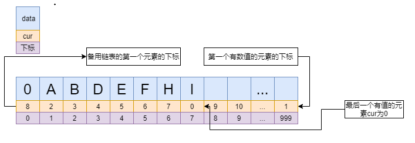

>插入一个元素   

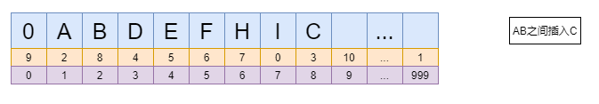

>删除一个元素   

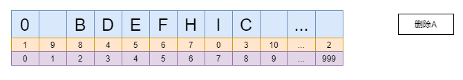

* 2.单链表
>每一个节点由数据域和指针域组成

>插入一个元素   

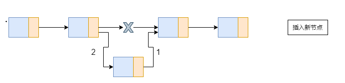

>删除一个元素   

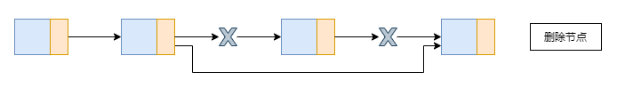

* 3.循环链表

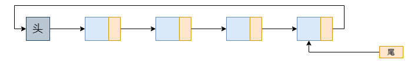

>合并链表  

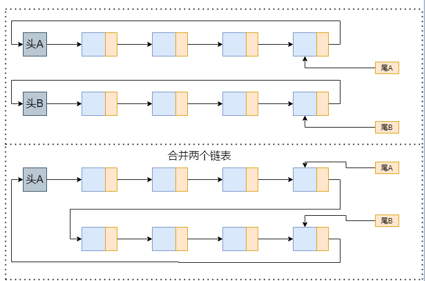

* 4.双向链表

>插入一个元素   

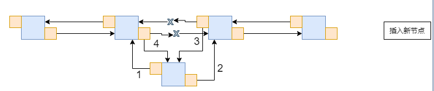

>删除一个元素   

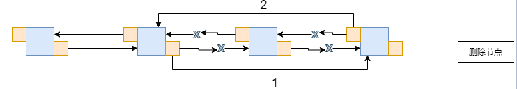

## 4-栈与队列


### 栈
栈是仅限于在表尾进行插入和删除操作的线性表

>链栈

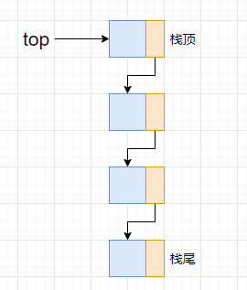
>出栈

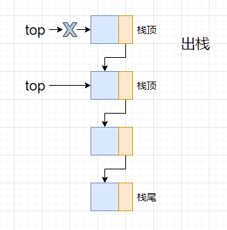
>入栈

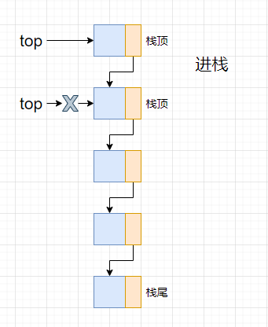

* 栈的应用：四则运算表达式求值

后缀表达式：所有的符号都是在要运算数字的后面出现
>后缀表达式计算结果    
规则：从左到右遍历表达式的每个数字和符号，遇到数字就进栈，遇到是符号，就将处于栈顶数字及栈顶下一个数字这两个数字出栈，进行运算（栈顶数字位于运算符右端，栈顶下一个数字位于运算符左端），运算结果进栈，一直到最终获得结果

>中缀表达式转后缀表达式   
规则：从左到右遍历中缀表达式的每个数字和符号，若是数字就输出，即成为后缀表达式的一部分；若是<font color=#008000>符号</font>，这个<font color=#008000>符号</font>先不入栈，然后判断个<font color=#008000>符号</font>与栈顶符号的优先级，是右括号或优先级不高于栈顶符号，则栈中元素依次出栈输出，并将当前<font color=#008000>符号</font>进栈，一直到最终输出后缀表达式为止

### 队列
队列是只允许在一端进行插入操作，而另一端进行删除操作的线性表

>链队列

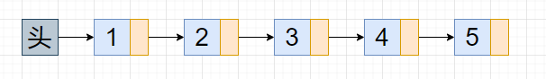

>入队列

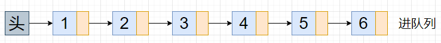

>出队列

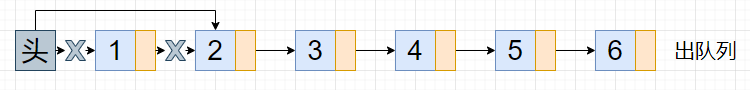

## 串


串是由零个或多个字符组成的有限序列，又叫字符串

### 串的顺序存储结构

### 串的链式存储结构

## 树


树是n(n>=0)个节点的有限集合   
n=0是空树   
只有一个根节点  
子树互不相交

节点分类：（度：子树数）   
度为0为叶节点，度不为0为分支节点   
树的度为各个节点的度的最大值   

节点层次：从根开始定义，根为第一层，根的孩子为第二层   
树的高度（深度）为树的最大层次  

### 树的存储结构
1. 双亲表示法
每个节点中，附设一个指针指向双亲节点（可以添加兄弟节点或孩子节点，灵活掌握）

2. 孩子表示法
多重链表表示法：每个节点有多个指针域，指向各个孩子节点   
孩子表示法：把每个节点的孩子节点排列起来，以单链表作存储结构，则n个孩子有n个孩子链表，然后n个头指针又组成一个线性表

3. 孩子兄弟表示法
任意一棵树，ta的节点的第一个孩子如果存在就是唯一的，它的右兄弟如果存在就是唯一的。设置两个指针分别指向该节点的第一个孩子和此节点的右兄弟（可以添加一个双亲指针来查找双亲的问题）   
孩子兄弟表示法把一颗复杂的树变成了一颗二叉树  

### 二叉树
二叉树n(n>=0)个节点的有限集合  
或者为空   
或者为一个根节点和两棵互不相交的树组成   
二叉树每个节点最多只有两棵子树    
左树和右树是有顺序的   
就算只有一棵子树，也要区分是左子树还是右子树

#### 二叉树分类
1. 斜树，所有节点都只有左子树或者只有右子树
2. 满二叉树，所有的分支节点都存在左子树和右子树，并且所有叶子都在同一层上
3. 完全二叉树，对一颗二叉树进行编号，如果编号为i的节点与同样的满二叉树编号为i的节点在树中位置完全相同，这棵二叉树称为完全二叉树

#### 二叉树性质
1. 在二叉树的第i层上至多有2<sup>i-1</sup>个节点（i>=1）
2. 深度为k的二叉树至多有2<sup>k</sup>-1个节点（k>=1）
3. 对于任何一棵二叉树，如果其终端节点数为n<sub>0</sub>，度为2的节点数为n<sub>2</sub>，则n<sub>0</sub>=n<sub>2</sub>+1
4. 具有n个节点的完全二叉树的深度为｜log<sub>2</sub>n｜+1
5. 如果对一棵有n个节点的完全二叉树（深度为｜log<sub>2</sub>n｜+1）的节点按层序编号（层数从上到校，每层从左到右），对任意节点：   
* 如果i=1，则节点i是二叉树的根，无双亲；如果i>1，则其双亲是节点i/2
* 如果2i>n，则节点i无左孩子（节点i为叶子节点）；否则其左孩子是节点2i
* 如果2i+1>n，则节点i为右孩子，否则其右孩子是节点2i+1

#### 二叉树的存储结构
1. 顺序存储结构   
用一维数组存储存储二叉树的节点
2. 二叉链表   
一个数据域和两个指针域，指针域分别存储左孩子节点和右孩子节点
3. 二叉树结构体
```
typedef struct BiNode
{
    int data;
    struct BiNode *lchild, *rchild;
}BiNode, *BiTree;
```

#### 遍历二叉树
1. 前序遍历    
<font color=#008000>先访问根节点</font>，然后前序遍历左子树，再后序遍历右子树    
算法    
```
void PreorderTraversal(BiTree T)
{
    if(T == NULL)
        return;
    printf("%c", T->data);
    PreorderTraversal(T->Lchild);
    PreorderTraversal(T->Rchild);
}
```
2. 中序遍历   
先中序遍历根节点的左子树，<font color=#008000>再访问根节点</font>，最后中序遍历右子树   
算法    
```
void MiddleorderTraversal(BiTree T)
{
    if(T == NULL)
        return;
    MiddleorderTraversal(T->Lchild);
    printf("%c", T->data);
    MiddleorderTraversal(T->Rchild);
}
```
3. 后序遍历    
从左到右先叶子后节点的方式遍历左右子树，<font color=#008000>最后访问根节点</font>    
算法    
```
void PostorderTraversal(BiTree T)
{
    if(T == NULL)
        return;
    PostorderTraversal(T->Lchild);
    PostorderTraversal(T->Rchild);
    printf("%c", T->data);
}
```
4. 层序遍历    
从根节点开始访问，从上往下逐层遍历，在同一层中，从左到右访问     

推导遍历结果   
1. 已知前序遍历和中序遍历可以确定一棵二叉树
2. 已知后序遍历和中序遍历可以确定一棵二叉树
3. 已知前序遍历和后序遍历不可以确定一棵二叉树

#### 线索二叉树
指向前驱和后继的指针称为线索，加上线索的二叉链表称为线索链表，相应的二叉树称为线索二叉树   
对二叉树以某种次序遍历使其变为线索二叉树的过程称作是线索化
线索二叉树结构
```
typedef enum {Link,Rhread} PointerTag;
typedef struct BiThrNode
{
    int data;
    struct BiThrNode *lchild, *rchild;
    PointerTag Ltag;
    PointerTag Rtag;
}BiThrNode, *BiThrTree;
```

中序遍历线索化
```
BiThrTree pre;
void InThreading(BiThrTree p)
{
    if(p)
    {
        InThreading(p->lchild)
        if(!p->lchild)
        {
            p->Ltag = Thread;
            p->lchild = pre;
        }
        if(!pre->rchild)
        {
            pre->Rtag = Thread;
            pre->rchild = p;
        }
        pre = p;
        InThreading(p->rchild);
    }
}
```

遍历
```
Status InOrderTraverse_Thr(BiThrTree T)
{
    BiThrTree p;
    p = T->lchild;
    while(p != T)
    {
        while(p->Ltag==Link)
        {
            p = p->lchild;
        }
        printf("%d", p->data);
        while(p->Rtag==Thread && p->rchild != T)
        {
            p = p->rchild;
            printf("%d", p->data);
        }
        p = p->rchild;
    }
    return OK;
}
```

#### 树与二叉树的转换
1. 树转换为二叉树
加线、去线、层次调整   
（所有兄弟节点之间加一条连线，对于每一个节点只保留它与第一个孩子的连线，删除它与其他孩子的连线）
2. 二叉树转换为树
加线、去线，层次调整
（如果某节点的左孩子存在，就将左孩子的n个右孩子（右孩子的右孩子）节点都作为此节点的孩子，之后删除所有原本的二叉树的右孩子连线）
3. 森林转换为二叉树
先将树转换为二叉树，之后第一棵二叉树不动，依次把一棵二叉树的根节点作为前一棵二叉树的根节点的右孩子
4. 二叉树转换为森林
若右孩子存在，就把与右孩子的连线删除，再查看分离后的二叉树，若右孩子存在，就把与右孩子的连线删除...之后将每棵二叉树转换为树即可

#### 赫夫曼树***
压缩与解码的基础

## 图


图是由顶点的有穷非空集合和顶点之间边的集合组成，通常表示为：G(V,E)，其中，G表示一个图，V是图G中顶点的集合，E是图G中边的集合

图中的数据元素称为顶点；在图中，不允许没有顶点；图中任意两个顶点之间都可能有关系，顶点之间的逻辑关系用边来表示   
无向边   
有向边（弧）   
简单图：不存在顶点到其自身的边，且同一条边不重复出现，则称这样的图为简单图   
完全图：任意两个顶点之间都存在边   
有向完全图   
稀疏图与稠密图是模糊的概念    
权：与图的边或弧相关的数字   
网：带权的图    
子图   

度：是顶点和顶点相关联的边的数目   
入度：顶点为头的弧的数目   
出度：顶点为尾的弧的数目
路径的长度是路径上的边或弧的数目   
第一个顶点到最后一个顶点相同的路径称为回路或环；序列中顶点不重复出现的路径称为简单路径。除了第一个顶点和最后一个顶点之外，其余顶点不重复出现的回路，称为简单回路或简单环   
无向图中任意两个顶点都是连通的则为连通图   
有向图中任意两个顶点都存在路径则为强连通图

### 图的存储结构
#### 邻接矩阵
图的邻接矩阵存储方式是用两个数组来表示图。一个一维数组存储图中顶点信息，一个二维数组存储图中的边或弧的信息
1. 顶点v<sub>1</sub>的入度为第v<sub>1</sub>列个数之和，顶点v<sub>1</sub>的出度为第v<sub>1</sub>行个数之和
2. 判断顶点v<sub>i</sub>到v<sub>j</sub>是否存在弧，只要查找arc[i][j]是否为1
3. 寻找v<sub>i</sub>的所有邻接点就是将第i行元素扫描，查找arc[i][j]为1即可

#### 邻接表
数组与链表相结合的存储方法
使用类似树的孩子表示法
1. 如果要知道某个顶点的度，即这个顶点的边表的节点个数
2. 判断v<sub>i</sub>到v<sub>j</sub>是否存在弧，就在顶点v<sub>i</sub>的边表中是否存在v<sub>j</sub>的下标即可
3. 求顶点的所有邻接点，对顶点的边表进行遍历
4. 对于有向图，以顶点为弧尾来存储边表

#### 十字链表
有向图的优化结构
邻接表和逆邻接表结合

#### 邻接多重表
无向图的优化结构

#### 边集数组
边集数组是由两个一维数组构成。一个是存储顶点的信息，另一个是存储边的信息，这个边数组每个数据元素由一条边的起点下标终点下标和权值组成

### <font color=#9000000>图的遍历*</font>
#### 深度优先遍历
从图的某个顶点v出发，访问此顶点，然后从v的未被访问的邻接点出发深度优先遍历图，直至图中所有和v有路径相通的顶点都被访问到。若图中有顶点未被访问到，则另选图中一个未被访问的顶点作起始点，重复上述过程。
类似域树的前序遍历

#### 广度优先算法
类似树的层序遍历

### <font color=#9000000>最小生成树*</font>
构造连通网的最小代价生成树称为最小生成树

### <font color=#9000000>最短路径*</font>

### <font color=#9000000>拓扑排序*</font>

### <font color=#9000000>关键路径*</font>

## 8-查找


### <font color=#9000000>顺序表查找*</font>

### <font color=#9000000>有序表查找*</font>

### <font color=#9000000>线性索引查找*</font>

### <font color=#9000000>二叉排序树*</font>

### <font color=#9000000>平衡二叉树*</font>

### <font color=#9000000>多路查找树*</font>

### <font color=#9000000>散列表查找*</font>

## 9-排序


### <font color=#9000000>冒泡排序*</font>

### <font color=#9000000>简单选择排序*</font>

### <font color=#9000000>直接插入排序*</font>

### <font color=#9000000>希尔排序*</font>

### <font color=#9000000>堆排序*</font>

### <font color=#9000000>归并排序*</font>

### <font color=#9000000>快速排序*</font>
