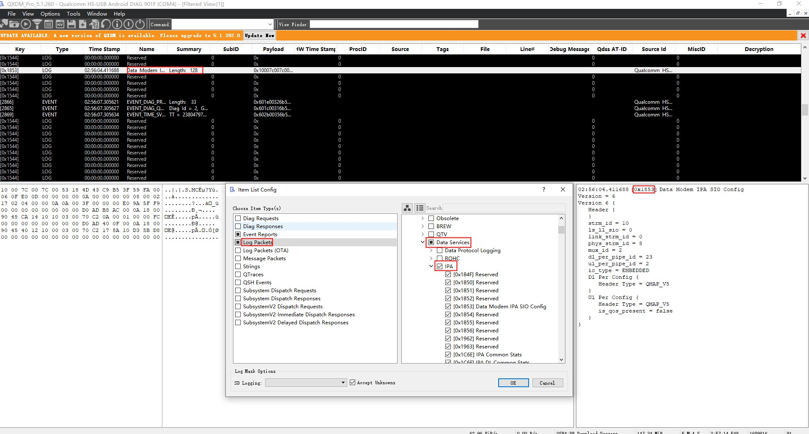
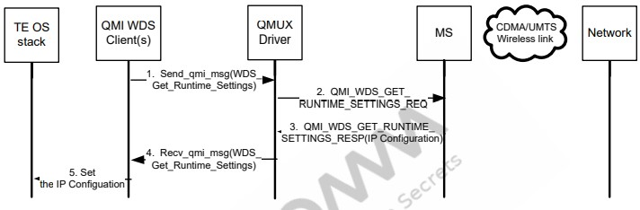
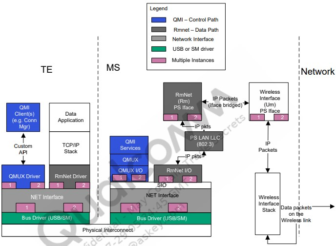

# Modem-IPA

## 1. 介绍

### 1.1. 功能
IPA IP accelerator   
modem IPA是一个独立的硬件块，可以从MPSS和APSS访问。它取代了上一代移动数据modem（MDM）芯片组的A2 PER块。   

1. 创建从modem子系统到应用程序和外围接口的直接硬件路径
2. 执行解密
3. 执行IP数据包过滤、路由和头添加和删除
4. 聚合和非聚合RNDI
5. 执行网络地址转换（NAT）
6. 卸载Wi-Fi移动热点
7. 支持XLAT（RFC 6877）
8. 桥接以太网

### 1.2. modem IPA 系统结构
   

## 2. IPA 功能 Hexagon
### 2.1. Hexagon IPA 驱动特点
以下是Hexagon IPA 驱动的特点   
1. 代替了以前MDMs使用的A2 PER驱动   
2. 通过IPA管理WWAN/Hexagon上的所有数据路径   

以下是Hexagon IPA 驱动的功能   
1. 管理 IPA<--> Hexagon BAM 管道
2. 管理WAN DL 过滤/路由表
3. 管理RmNet/MBIM调用的标头插入表
4. 管理RmNet/MBIM呼叫的UL 过滤/路由表
5. 管理解密规则表
6. 基于活动的IPA时钟选择
7. IPA调试支持
8. 数据/控制路径统计记录
9. RmNet或MBIM调用上的端到端流控制
10. 通过高通调制解调器接口（QMI）进行驱动程序间通信
11. 使用IPA过滤来卸载以下UL软件路径中的包检查用例
    1. DHCP/IP片段数据包
    2. Qos 匹配
    3. 数据包优先级(TCP ACK)
    4. IPv6前缀比较

### 2.2. 使能IPA log packages

#### 2.2.1. IPA_STATS
    Log code – 0x184F
    Description – 包含所有 IPA 驱动程序统计信息快照的定期日志

#### 2.2.2. IPA_IPLFTR_STATS
    Log code – 0x1850
    Description – 包含所有 IPA 驱动程序筛选器命中统计信息快照的定期日志

#### 2.2.3. IPA_SIO_CFG
    Log code – 0x1853
    Description – 建立新的QMI调用时事件触发的日志;捕获 SIO 配置。例如，聚合参数

#### 2.2.4. IPA_WAN_CFG
    Log code – 0x1854
    Description – 启动新持有者时触发的事件日志;捕获持有者配置。例如，启用了 DPL

#### 2.2.5. IPA_FLTR_TBL_UPDATE
    Log code – 0x1855
    Description – 添加新的过滤规则时事件触发的日志;转储新的筛选器表

#### 2.2.6. IPA_RTNG_TBL_UPDATE
    Log code – 0x1856
    Description – 添加新路由规则时事件触发的日志;转储新路由表

### 2.3. 分析IPA_STATS日志数据包
    IPA_STATS日志数据包包含以下部分：
    CFG – IPA 驱动程序维护顶级配置信息
    CTL – IPA 驱动程序维护所有 CTL 统计信息
    DL – IPA 驱动程序维护所有 DL 统计信息
    UL – IPA 驱动程序维护所有 UL 统计数据
    MHI – IPA 驱动程序维护所有 MHI 统计信息

### 2.4. 分析IPA下载警告统计
    IPA DL警告统计信息如下：
    p_drop_excep_pkts–IPA驱动程序由于IP异常而丢弃的数据包数
    p_drop_excep_bytes–IPA驱动程序由于IP异常而丢弃的字节数
    p_drop_holb_pkts–QMI呼叫断开时IPA驱动程序清除的数据包数
    p_drop_holb_bytes–QMI呼叫断开时IPA驱动程序清除的字节数
    num_ooo_frag_drops–超时后丢弃的IPv4无序片段数
    num_desc_pipe_full–由于硬件BAM描述符队列已满，IPA驱动程序无法将DL数据包编程到IPA硬件的次数
    num_imm_cmd_buf_full–因为硬件立即命令队列已满，IPA驱动程序无法将DL数据包编程到IPA的次数num_pdcp_wm_dne_pkts–pdcp中丢弃的数据包的累积数量→IPA水印由于队列溢出
    num_pdcp_wm_dne_bytes–pdcp中丢弃的累积字节数→IPA水印由于队列溢出
    num_sio_wm_dne_pkts–DS中丢弃的数据包的累积数量→IPA水印到期队列溢出
    num_sio_wm_dne_bytes–DS中丢弃的累积字节数→IPA水印由于队列溢出
    num_ds_wm_dne_pkts–IPA中丢弃的数据包的累积数量→DS水印到期排队溢出（已过滤或未桥接数据）
    num_ds_wm_dne_bytes–IPA中丢弃的累积字节数→DS水印由于队列溢出（已过滤或未桥接数据）

### 2.5. 分析IPA上传警告统计
    以下是各种IPA DL警告统计信息：
    p_drop_pkts–IPA驱动程序丢弃的数据包数
    p_drop_bytes–IPA驱动程序丢弃的字节数
    p_drop_excep_pkts–IPA驱动程序由于IP异常而丢弃的数据包数
    num_sio_wm_dne_pkts–IPA中丢弃的数据包数→队列导致的DS水印溢流
    num_sio_wm_dne_bytes–IPA中丢弃的字节数→队列导致的DS水印溢流

### 2.6. 分析IPA_SIO_CFG log 包
    以下是重要的日志包参数：
    DL_PER_CFG–显示为外围管道上的调用协商的DL聚合参数
    Header type–QMAP、QMAPv3、MBIM等
    max_aggr_pkts–聚合最大数据包限制
    max_aggr_bytes–聚合最大字节限制

    UL_PER_CFG–显示为外围管道上的调用协商的UL聚合参数
    Header type–QMAP、QMAPv3、MBIM等
    max_aggr_pkts–聚合最大数据包限制
    max_aggr_bytes–聚合最大字节限制

### 2.7. 使能IPA 事件报告
    以下是IPA事件报告：
    IPA_DROP_PKT_DL
    事件代码–0x09F9
    描述–每当数据包在DL中丢失时引发的事件；在事件中捕获丢弃原因和数据包长度

    IPA_DROP_PKT_UL
    事件代码–0x09FA
    描述–每当在事件中捕获数据包时引发的事件

## 3. IPA 功能 Arm Cortex-A7
    Arm Cortex-A7 IPA 软件特点
    硬件加电初始化
    IPA共享内存管理
    Hexagon IPA驱动 IPC通信
    数据路径配置
    管理WLAN和USB端点上的LAN/WAN过滤
    管理去往LAN客户端的数据包路由
    管理NAT表
    管理（与Hexagon IPA驱动程序一起）与调制解调器数据路径之间的数据包路由
    通过外围设备设置BAM到BAM和/或BAM到SYS模式数据路径
    通过软件数据路径的IPA进行数据传输
    省电
    与外围驱动器协调IPA时钟选通
    选择（独立）通过RPM开启/关闭IPA时钟

### 3.1. 在Arm Cortex-A7 上使能IPA packets log

#### 3.1.1. 内核dmesg log
    adb shell dmesg | tee dmesg_log.txt

#### 3.1.2. IPA log
    cat /sys/kernel/debug/ipa/hdr – 显示在IPA中注册的标头
    cat /sys/kernel/debug/ipa/ip4_rt – 显示IPA中的IPv4路由规则
    cat /sys/kernel/debug/ipa/ip4_flt – 显示IPA中的IPv4筛选规则
    cat /sys/kernel/debug/ipa/ip6_rt – 显示IPA中的IPv6路由规则
    cat /sys/kernel/debug/ipa/ip6_flt – 在IPA中显示IPv6筛选规则
    cat /sys/kernel/debug/ipa/stats – 显示IPA统计信息
    cat /sys/kernel/debug/ipa/msg – 显示WLAN发送到IPA的消息
    cat /sys/kernel/debug/ipa/ip4_nat – 显示IPA NAT表
    cat /sys/kernel/debug/ipa/wstats – 显示WLAN呼叫的IPA统计信息

#### 3.1.3. 从Cortex-A7收集一般信息
    ifconfig
    route –n
    brctl show
    conntrack –L

#### 3.1.4. 从A7收集TCPDUMP
    tcpdump -i bridge0 -w bridge0.pcap

#### 3.1.5. 要手动启动IPACM并从启动中获取完整的IPACM日志
    1. Power on the device
        a. adb shell or in serial port – serial port is used when issue is related to USB cable plug-in/out operation.
        b. cd etc/init.d
        c. mv start_ipacm_le start_ipacm_le_bk – disables the Daemon mode
        d. reboot
        e. ps -ef – ensures IPACM is not running
        f. adb shell or in serial port
        g. cd /usr
        h. ipacm > ipacm_log.txt & – issue this command to start IPACM and write to file under /usr
    2. Run IPACM before bringing up any interface

#### 3.1.6. 收集资源管理器日志详细驱动程序操作
    mount -t debugfs none /sys/kernel/debug/
    klogd -c 8
    echo "file ipa_rm.c +p" > /sys/kernel/debug/dynamic_debug/control
    echo "file ipa_rm_resource.c +p" > /sys/kernel/debug/dynamic_debug/control
    echo "file ipa_client.c +p" > /sys/kernel/debug/dynamic_debug/control
    echo "file ipa_utils.c +p" > /sys/kernel/debug/dynamic_debug/control
    echo "file ipa_rm_dependency_graph.c +p" > /sys/kernel/debug/dynamic_debug/control
    Then collect dmesg log
    cat /sys/kernel/debug/ipa/rm_stats – prints all producer resources, their consumers’dependencies, and states.

#### 3.1.7. 收集ECM_IPA 驱动日志详细驱动程序操作
    mkdir /d
    mount -t debugfs none /d
    echo "module ecm_ipa +pmflt" > /d/dynamic_debug/control
    cat /d/ecm_ipa/outstanding – Current outstanding counter (this shows how many Tx [Device→Host] packets were not proceeded by hardware)

#### 3.1.8. 收集RNDIS_IPA 驱动日志详细驱动程序操作
    mkdir /d
    mount -t debugfs none /d
    echo "module rndis_ipa +pmflt" > /d/dynamic_debug/control
    cat /d/rndis_ipa/outstanding – Current outstanding counter (this shows how many Tx [Device→Host] packets were not proceeded by hardware)
    
#### 3.1.9. 要收集系留桥驱动日志
    mount -t debugfs none /sys/kernel/debug 
    echo 'file teth_bridge.c +p' > /sys/kernel/debug/dynamic_debug/control

#### 3.1.10. IPA 输出统计描述
    cat /sys/kernel/debug/ipa/stats
        sw_tx – 从A7发送的ECM/RNDIS数据包数
        hw_tx – 从A7发送的QMAP数据包数
        tx_compl – 接收到的发送完成数
        wan_rx – 在A7从Hexagon接收的数据包数
        stat_compl – 硬件路径上来自ECM/RNDIS/WLAN的数据包数
        lan_aggr_close – 在LAN Rx管道上关闭聚合的次数
        wan_aggr_close – 在WAN Rx管道上关闭聚合的次数
        act_clnt – 应用程序处理器端IPA时钟的向上选择数
        con_clnt_bmap – 连接客户端的位图；位n对应于EP n
        lan_rx_excp[0: IPA_EXCP_DEAGGR] – 反聚集异常数
        lan_rx_excp[2: IPA_EXCP_IP] – 非IP数据包异常数
        lan_rx_excp[3: IPA_EXCP_IHL] – 错误IP数据包标头长度异常数
        lan_rx_excp[4: IPA_EXCP_FRAG_MISS] – 片段未命中异常数
        lan_rx_excp[5: IPA_EXCP_SW] – 软件异常数
        lan_rx_excp[6: IPA_EXCP_NAT] – NAT异常数
        lan_rx_excp[7: IPA_EXCP_NONE] – 实际发送到应用程序处理器的LAN Rx数据包数

#### 3.1.11. WLAN 输出统计描述
    cat /sys/kernel/debug/ipa/wstats
    Client IPA_CLIENT_WLAN1_PROD statistics
        Avail FIFO Desc – 可用的自由可用的描述符数
        Rx Pkts Rcvd – WLAN驱动程序发送到IPA的数据包
        Rx Pkts Status Rcvd – UL中从IPA硬件接收的状态数据包
        Rx DH Rcvd – WLAN发送的数据描述符
        Rx DH Processed – IPA处理的数据描述符
        Rx DH Sent Back – 数据描述符从IPA发送回WLAN驱动程序进行回收
        Rx Pkt Leak – 未从IPA硬件接收到状态的数据包，这会导致内存泄漏
        Rx DP Fail – 数据包无法从IPA驱动程序传输到IPA硬件
    Client IPA_CLIENT_WLANx_CONS statistics
        Tx Pkts Received – 从IPA硬件接收的数据包
        Tx Pkts Sent – IPA发送到WLAN的数据包
        Tx Pkts Dropped – IPA丢弃的数据包
    All WLAN consumer pipes statistics
        Tx Comm Buff Allocated – 以DL为单位分配的缓冲区总数
        Tx Comm Buff Avail – DL中可用的空缓冲区
        Total Tx Pkts Freed – 循环缓冲区计数

## 1. RmNet for modem IPAs

QTI-MSM™中的RmNet特性 设备模拟所连接的终端设备（TE）的网络接口。MSM的RmNet功能在连接到TE时充当网络适配器，并向连接的TE提供分组数据连接。术语TE包括所有形状因素，包括以下装置：
PC、笔记本或应用程序处理器。网络（RmNet）设备与其他逻辑设备（例如，调制解调器、诊断、NMEA）共存。
RmNet依赖于TE和移动站（MS）之间的任何控制信令的控制接口。

例如，按需启动数据会话、发送任何通知等。目前，RmNet仅支持高通MSM接口（QMI）作为TE和MS之间信令的控制信道。QMI定义了TE和MS上应用程序或驱动程序之间通信的框架和消息。

支持的功能如下：
IPv4数据连接
自动连接模式
多RmNet
原始IP模式（并非所有产品都支持）
QoS（并非所有产品都支持）
支持互连–USB和共享内存
IPv6数据连接

### 1.1. RmNet 结构

在数据路径中，RmNet不使用PPP，因此消除了TE和MS之间链路上与PPP相关的高级数据链路控制（HDLC）成帧或解帧开销
默认情况下，RmNet使用802.3帧。RmNet还支持传输原始IP数据包（请参阅原始IP一节）。当使用原始IP模式时，不使用LAN LLC和ARP模块
DHCP v4服务器和PS ARP模块仅用于IPv4。如果TE在TE上使用DHCP进行IP地址配置，则使用DHCP v4 server（请参阅RmNet地址分配后的TE IP一节）
ICMPv6模块仅用于IPv6、邻居发现、DAD和无状态地址自动配置
单个RmNet接口（实例）一次仅支持IPv4或IPv6中的一种。要同时拥有IPv4和IPv6数据会话，每个会话必须通过单独的RmNet接口

### 1.2. RmNet帧格式
本节讨论通过RmNet互连（USB，共享内存）传输的数据包支持的帧格式。

#### 1.2.1. 数据链路层
数据链路层格式如下图所示。在此格式中，IP数据包在802.3帧内发送。这是默认的数据格式。

#### 1.2.2. 原始IP
在这种格式中，交换原始IP数据包时不需要任何802.3报头。TE上的QMUX驱动程序向MS发送QMI_ CTL请求以使用原始IP数据格式。在建立任何数据会话之前，必须在通电初始化期间执行此操作。TE应仅在MS发送指示使用原始IP模式的响应之后才采用原始IP数据格式；否则，默认为802.3模式   

#### 1.2.3. QoS流报头
仅当使用QMI QoS功能时，才应使用QoS流标头数据格式。QMI QoS功能通过无线网络向TE上的应用程序提供对QoS的访问。在这种数据格式中，QoS流报头添加在数据包的前面   

客户端使用QMI_ CTL消息通知MS此数据格式，如下图所示。在建立任何数据会话之前，必须在通电初始化期间执行此操作。TE应仅在从MS接收到成功响应后才采用此数据格式   

### 1.3. RmNet数据会话管理
本节讨论了涉及RmNet数据会话设置和结束的各种场景，如下所示：
1. 数据会话建立–描述TE请求MS建立数据会话时涉及的步骤
2. TE IP配置–描述为TE分配IP地址和其他IP配置的过程；以下是两种可能的方法
    使用标准协议
        DHCP – TE使用DHCP过程获取IP配置（对于IPv4）
        使用ICMPv6的无状态地址自动配置（适用于IPv6）
    使用QMI – TE使用QMI消息获取IP配置（仅适用于IPv4）

3. 数据会话拆除—描述TE请求MS拆除数据会话时涉及的步骤
4. 自动连接模式–描述自动连接操作模式，在这种模式下，数据会话自动建立或拆除，无需TE的明确请求
5. IP地址更改–描述通知并向TE传达新IP配置的过程

数据会话建立或结束过程中涉及的组件包括：
1. TE OS堆栈–运行在TE上的本机OS数据堆栈
2. QMI WDS客户端–QMI无线数据服务客户端发送和接收WDS消息；负责使用特定于主机操作系统的API向TE OS堆栈通知数据连接和IP配置
3. QMUX驱动程序–QMUX为QMI客户端和服务提供传输。客户端通过运行在TE上的QMUX驱动程序公开的API发送和接收QMI消息。
4. MS–QMI服务所在的移动站
5. 网络–无线网络

#### 1.3.1. RmNet数据会话设置
RmNet数据会话的前提条件和后条件如下：
    前提条件–QMI WDS客户端已成功从MS获取客户端ID。
    后条件–MS已从网络获得IP配置。   

以下步骤对应于上图：

1. TE上的客户端发送启动RmNet数据会话的请求。
2. QMUX驱动程序在将请求发送给MS之前将QMUX头添加到请求中。
3. 在接收到该请求时，MS启动启动数据会话OTA的过程。
4. 一旦OTA数据会话启动，MS向发起请求的客户端发送指示成功的响应。在呼叫发起失败时，MS发送失败响应，并且以下步骤不会发生。
5. QMUX驱动程序删除QMUX头并将响应消息传递给适当的客户端。
6. MS还发送广播指示以通知数据会话现在已连接。
7. TE上的QMUX驱动程序将其转发给QMI WDS客户端。

#### 1.3.2. RmNet地址分配后的TE IP
##### Ipv4地址使用DHCP
使用DHCPv4的前提条件和后条件如下：
    前提条件–必须在此之前设置数据会话。
    后置条件–TE IP配置完成并传输数据包。   

以下步骤对应于上图：
1. WDS客户端通知运行在TE上的OS数据链路已建立。
2. 步骤2至5：在TE和MSM之间进行DHCP协商，以向TE分配IP地址和其他IP配置。分配给TE的IP地址与网络分配给MS的IP地址相同。

##### 使用IPv6地址的无状态地址自动配置
IPv6地址无状态地址自动配置的前提条件和后条件如下：
    前提条件–必须在此之前设置数据会话。
    后置条件–TE IP配置完成并传输数据包。   

以下步骤对应于上图：
1. WDS客户端通知运行在TE上的OS数据链路已建立。
2. 步骤2至4.TE必须进行DAD和无状态地址自动配置以配置地址。

##### 使用QMI(仅限Ipv4)
使用QMI的前提条件和后条件如下：
    前提条件–必须在此之前设置数据会话。
    后置条件–TE IP配置完成并传输数据包。

以下步骤对应于上图：
1. 步骤1至2，WDS客户端向MS发送请求，以查询要在TE上设置的IP配置。
2. 在步骤3至4中，MS用IP地址和其他配置进行响应。分配给TE的IP地址与网络分配的IP地址相同。
3. 步骤5，客户端然后使用特定于主机的API在TE上配置该IP地址和其他配置参数。

##### RmNet保护定时器
当与无线网络建立数据会话时，启动保护定时器。TE需要在该定时器到期之前查询其IP配置（如使用DHCP作为IPv4地址到使用QMI（仅IPv4）的部分所示）。如果在TE从设备查询IP配置之前计时器过期，则数据会话被中断。这样做是为了节省无线网络资源。保护定时器值设置为2分钟。

#### 1.3.3. RmNet数据会话结束
拆除RmNet数据会话的前提条件和后条件如下：
    前提条件–数据会话设置较早。
    后置条件–数据会话被中断，TE失去IP连接

数据会话结束发生如下：
1. 客户端发送停止RmNet数据会话的请求。
2. QMUX驱动程序将QMUX报头添加到消息中，并将请求发送给MS。
3. MS发起呼叫分离OTA。
4. MS发送以客户端为目的地的成功响应。
5. QMUX驱动程序删除QMUX头并将响应传递给适当的客户端。
6. MS还发送广播指示以通知数据会话被断开。
7. TE上的QMUX驱动程序将其转发给WDS客户端。
8. WDS客户端通知TE上运行的OS数据链路已终止。

#### 1.3.4. RmNet自动连接会话建立和结束
前面的部分说明了手动启动和终止数据会话的机制。为了支持常开操作，RmNet具有自动连接模式，启用该模式后，当设备连接到TE时，会自动启动数据会话，当设备与TE断开连接时，会将其自动断开。自动连接仅适用于RmNet上的即插即用互连，如USB

要设置自动连接数据会话，请执行以下操作：
1.  MS获知USB已连接。例如通过DTR高。
2.  MS启动数据会话OTA。
3.  MS发送广播QMI无线分发服务（WDS）指示以通知数据会话已连接。
4.  TE上的QMUX驱动程序将其转发给WDS客户端。
5.  然后，WDS客户端通知TE上运行的OS数据链路已建立。
6.  TE的IP配置使用DHCP或QMI执行，如下文TE IP部分所示RmNet地址分配。

要设置自动连接数据会话结束，请执行以下操作
1.  MS获知USB断开。例如通过DTR低。
2.  MS中断数据会话OTA。
3.  MS发送广播QMI WDS指示以通知数据会话断开。
4.  TE上的QMUX驱动程序将其转发给WDS客户端。
5.  然后，WDS客户端通知TE上运行的OS数据连接已终止。

在自动连接模式操作期间，数据会话因USB断开以外的原因断开。例如，信号丢失等。RmNet设备尝试使用退避机制重新建立数据会话。RmNet以1秒的定时器启动。每次数据会话建立尝试失败（设备的较低层或网络拒绝），它会将定时器后退两倍，然后MS在定时器过期时再次尝试。定时器回退最多持续两分钟，之后RmNet每两分钟重试一次。在此过程中，如果任何尝试成功，定时器将重置回一秒的原始值。

#### 1.3.5. TE上的IP地址更改
更改IPv4或IPv6地址的前提条件和后条件如下：
    前提条件–数据会话已启动，TE上的IP地址已配置
    后置条件–通知TE IP地址更改，并再次执行TE IP地址配置

要更改IP地址，请执行以下操作：
1. 发生切换，导致MS IP地址改变。
2. MS发送广播WDS指示以通知数据会话已连接，但需要重新配置。
3. TE上的QMUX驱动程序将其转发给QMI WDS客户端。
4. WDS客户端通知TE上运行的OS必须重新配置数据链路IP配置。

### 1.4. 与不同设备和接口的互连
目前，通过USB和共享内存互连支持RmNet。支持一个或多个网络设备（RmNet逻辑设备）。
每个逻辑设备必须有单独的数据和控制通道。信道独立性意味着每个信道必须像通信信道之间没有物理耦合一样工作，包括（但不限于）单独的Tx和Rx路径队列、独立的流控制机制和独立的数据传输调度。互连必须提供交换的数据包的帧，即，描绘传输协议的包边界。
为了支持多个逻辑设备，底层互连必须提供一种机制，用于在单个物理连接上多路复用多个逻辑器件。

### 1.5. 多RmNet
Multi-RmNet是指支持多个逻辑设备，即网络接口。Multi-RmNet功能支持多个IP数据会话（每个会话是IPv4或IPv6）。最多同时使用三个RmNet实例。

每个RmNet逻辑设备在TE上显示为独立的网络适配器，能够获得自己的IP地址并独立传输数据。下图显示了两个RmNet实例的情况。每个实例在单独的端口上运行，并且独立于其他实例：

### 1.6. RmNet配置参数
下表列出了支持的RmNet配置参数。这些仅适用于USB上的RmNet。
1. 配置参数：USB_CURRENT_DEVICE (FS-USB) – NV item 2782、HS_USB_CURRENT_COMPOSITION (HS_USB) - NV item 4526
   描述：确定RmNet是否是USB组合的一部分；必须设置为包含RmNet的合成值
   默认值：0（RmNet不存在）

2. 配置参数：RMNET_AUTOCONNECT – NV item 3534
   描述：确定是否启用RmNet自动连接；仅适用于USB上的RmNet；它由两部分组成。索引和启用或禁用设置；该索引表示RmNet实例（目前仅支持一个实例，即索引0）；第二个组件设置为1或0，以启用或禁用该特定索引上的自动连接
   默认值：｛0，0｝（自动连接已禁用）

### 1.7. 非IP数据传输
非IP数据传输（NIDD）是NB引入的一项新功能。
请参阅以下规范中的非IP数据传输支持（NIDD）：
用于演进型通用地面无线接入网（E-UTRAN）接入的通用分组无线业务（GPRS）增强功能（3GPP TS 23.401版本14.4.0）

#### 检查平台或构建是否支持它
非IP根据FR38978（CR2010416和CR2046848）实施。它由MPSS.JO3.0.2的后期CS交付。在此之后的任何构建都应包括这些CRs。
对于任何其他平台或构建，检查这些CRs是否适用。

#### 支持的调用流
支持：仅支持AP嵌入式和系留RmNet调用。
不支持：调制解调器嵌入呼叫，DUN。

## 1. 为modem配置IPACM

IPACM工具自动配置每个活动接口的路由、筛选和网络地址转换规则，包括互联网协议加速器（IPA）硬件中的IPACM客户端。如果IPACM在设备启动期间处于守护程序模式，它将侦听来自Linux内核的多个netlink或conntrack事件，并配置IPA硬件。IPACM配置文件以XML格式定义为IPACM_cfg.xml位于设备上的根/etc文件夹下。

### 1.1. 用IPACM XML文件配置网络属性
    Monitored interfaces
    Private subnets
    ALG ports
    Max IPACM NAT entry

#### 1.1.1. 配置接口去监测IPACM
    使用<IPACMIface>指定受监控的接口架构标记。IPACMIface标记包含带有接口配置的子部分。

##### 1.1.1.1. 配置接口条目架构
    使用<Iface>标记指定每个受监控的接口条目模式。Iface标记包含用于指定接口名称和类别的子部分。

##### 1.1.1.2. 配置接口名
    使用<Name>标记指定IPACM监控的接口名称

##### 1.1.1.3. 配置接口类别
    使用＜Category＞标记指定IPACM监控的接口类别
    LAN
    WAN
    WLAN
    UNKNOWN
    VIRTUAL

##### 1.1.1.4. 配置模式(可选)
    使用<Mode>标记指定回程接口（调制解调器或USB支架回程）的操作模式。模式标记仅对WAN接口类别有效。

    如果默认情况下模式标记不存在，则接口设置为路由器模式(Router)。在路由器模式下，设备由调制解调器或外部路由器分配公共IP。

    网桥模式(Bridge)意味着设备没有公共IP；并且它桥接到调制解调器或外部路由器。

##### 1.1.1.5. 配置WlanMode(可选)
    使用<WlanMode>标记指定WLAN接口操作的访问模式类型。WLAN模式标签仅在接口为WLAN时有效。例如，wlan0、wlan1等。如果默认情况下不存在WlanMode标记，则WLAN接口设置为full模式。

###### 1.1.1.5.1. Full 模式
    与处于完全模式的接入点相关联的Wi-Fi客户端可以完全访问调制解调器（公共网络）和其他AP或USB客户端。

###### 1.1.1.5.2. Internet 模式
    与Internet模式上的接入点关联的Wi-Fi客户端仅访问调制解调器（公共网络），但与其他AP/USB客户端的LAN通信被阻止。

    与同一接入点关联的Wi-Fi客户端始终在Internet和full模式下采用IPA-HW路径。

#### 1.1.2. 配置IPACM专用子网
    使用<IPACMPrivateSubnet>标记指定IPACM私有子网架构。IPACMPrivateSubnet标记包含带有IPACM中使用的子网配置的子部分。

    MDM9x25、MDM9x35和MDM9x45 MAX中有三组。请在IPACM_Def.h头文件中更新IPA_MAX_PRIVATE_SUBNET_ENTRIES以配置更多子网。

##### 1.1.2.1. IPACM子网条目架构
    使用＜Subnet＞标记指定每个IPACM配置的子网条目架构。子网标记包含用于指定子网地址和子网掩码的子部分。

##### 1.1.2.2. 配置子网地址
    使用SubnetAddress标记来配置ipv4子网地址

##### 1.1.2.3. 配置子网掩码
    使用SubnetMask标记来配置ipv4子网掩码

#### 1.1.3. 配置IPACM ALG 端口列表
    使用<IPACMALG>指定IPACM ALG端口架构标记。IPACMALG标记包含带有受监控应用程序级网关（ALG）端口配置的子部分。这些受监控的ALG端口上的流量被重定向到Linux堆栈，而不是IPA硬件。MDM9x25芯片组支持的最大端口数是10。对于MDM9x35和MDM9x45芯片组，最大端口数为20。头文件IPACM_Def.h中更新IPA_MAX_ALG_ENTRIES以配置更多ALG端口

##### 1.1.3.1. 配置ALG条目
    使用＜ALG＞标记指定每个IPACM ALG条目架构。ALG标签包含用于指定ALG端口和协议的子部分。

##### 1.1.3.2. 配置协议
    使用＜Protocol＞标记指定ALG协议
    UDP/TCP

##### 1.1.3.3. 配置端口
    使用＜Port＞标记指定ALG端口

#### 1.1.4. 配置IPACM NAT
    使用＜IPACMNAT＞标记指定IPACM NAT架构。IPACMNAT标记包含最大数量的NAT条目。

#####  1.1.4.1. 配置MaxNatEntries
    使用<MaxNatEntries>标记指定IPACM可以支持的最大实时NAT条目

#### 1.1.5. 使用IPACM XML文件配置ODU属性
    QCMobileAP可以动态修改XML组件条目。IPACM被动应用更改。

    <ODUCFG>是IPACM中的ODU配置数据库模式标记。ODUCFG标记包含具有以下配置的子部分：
    模式
    eMBMS流量IPA卸载

##### 1.1.5.1. 配置子网条目模式
    使用＜Mode＞标记指定每个ODUCFG配置的子网、条目模式。模式标记包含用于指定设备上ODU配置的工作模式的子部分。

###### 1.1.5.1.1. Mode
    使用＜Mode＞标记指定ODU模式
    Router/Bridge

###### 1.1.5.1.2. eMBMS_offload
    使用<eMBMS_offload>标记指定DL eMBMS流量是否采用IPA-HW路径

## 1. issue

高通公司需要QXDM和IPACM日志、TCP转储和网络设备配置信息，以进行数据暂停和T-put问题调试。

### 1.1. 默认log配置的从启动开始的qxdm log

### 1.2. IPACM log

#### 1.2.1. 支持systemd的平台--SA415、SDx55、SA515及以上
1. 将设备置于selinux permissive模式
    vi /etc/selinux/config
    change enforcing --> permissive

2. 在ipacm服务文件的[Service]部分插入以下内容
    vi /lib/systemd/system/ipacm.service
    StandardOutput=file:/data/ipacm_log.txt

3. 重新启动DUT以使服务文件生效
4. 执行测试 & 在设备重启之前拉取/data/ipacm_log.txt

#### 1.2.2. 不支持systemd的平台--sdx24, sdx20, 9x40(9640), 9x50等
1. killall -15 ipacm
2. ipacm>/data/ipacm_log.txt &
3. adb pull /data/ipacm_log.txt

### 1.3. 在adb shell中输出一般A7信息
1. ifconfig
2. brctl show
3. route -n
4. brctl show
5. conntrack -L
6. conntrack -E
7. ip n s
8. ip r s
9. arp
10. iptables -t filter -L -n -v
11. iptables -t mangle -L -n -v
12. iptables -t nat -L -n -v

### 1.4. tcp dump and pc wireshark
    ifconfig输出中每个网络设备的tcp dump
    PC wireshark

### 1.5. IPA 统计信息
1. Common Logs required for both MSM/MDM
    Common logs for v4/v6 for all platforms:
    cat /sys/kernel/debug/ipa/stats (couple of times during UL data transfer only)
    cat /sys/kernel/debug/ipa/hdr
    cat /sys/kernel/debug/ipa/msg
    cat /sys/kernel/debug/ipa/status_stats (during UL data transfer only)

2. V4 data transfer:
    cat /sys/kernel/debug/ipa/ip4_flt
    cat /sys/kernel/debug/ipa/ip4_rt
    cat /sys/kernel/debug/ipa/ip4_nat

3. V6 data transfer:
    cat /sys/kernel/debug/ipa/ip6_flt
    cat /sys/kernel/debug/ipa/ip6_rt

4. dmesg > /data/dmesg_log.txt

### 1.6. 捕获ipa驱动的ipc_logs
    cat /sys/kernel/debug/ipc_logging/ipa/log > /data/ipa_ipc_logs.txt

### 1.7. 具有有效应用程序和调制解调器符号的崩溃转储（在结束时，但在数据传输期间）

### 1.8. 提供 mobileap_cfg.xml and IPACM_cfg.xml 配置文件

### 1.9. 使用adb shell 的命令“top”检查A7处理器CPU负载。在执行测试和执行测试过程之前，需要查询CPU负载
